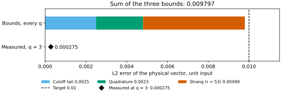

# LCHS

<a id="lchs-for-linear-dynamics"></a>LCHS (linear combination of Hamiltonian simulation) computes the solution at time $T$ of the linear ODE $du/dt=-Au+b$ for a constant matrix $A$, an initial vector $u(0)$ and an optional constant source $b$. It splits $A=L+iH$ into the Hermitian parts $L=(A+A^\dagger)/2$ and $H=(A-A^\dagger)/(2i)$ and, for positive semidefinite (PSD) $L$ and the default near-optimal kernel $g_\beta$, writes the propagator as a weighted integral of unitary evolutions,

```math
e^{-AT}=\int_{\mathbb R}g_\beta(k)\,e^{-iT(kL+H)}\,dk,
```

which NWQLib truncates to $|k|\le K$ and replaces by a finite quadrature sum (An, Childs and Lin, arXiv:2312.03916v2, here ACL, Eqs. (3)–(4), (6)–(7) and Theorem 6, stated as [Result 25](../mathematics.md#r25)). A constant source adds the Duhamel term $\left(\int_0^Te^{-As}\,ds\right)b$ of their Eq. (2).

Use LCHS for the state of a linear dynamical system at a given time. For a steady state $Ax=b$, use [QLS](qls.md). For the default kernel–quadrature pair, `approx_tol=0.01` limits two discretization error components, the cutoff tail and the k quadrature. It does not bound the total error of the output ([Selection and accuracy](#selection-and-accuracy)). [LCHS derivations](lchs_derivations.md) gives the relations behind sampled scores and radii, node and joint encodings, constant-source and analytic preparation and the Apel–Berntson kernel.

$A$ can be a dense matrix or a compact form that LCHS never expands into a matrix of the system dimension: a Pauli sum, a periodic band operator, its Hermitian parts $L$ and $H$ given separately, a block-encoding circuit you supply, or a periodic stencil ([Inputs](#inputs)). The default coherent estimator applies the whole finite sum in one circuit and returns any of the [outputs](#outputs). For a norm or an observable of $u(T)$, `estimator="sampled_pairs"` instead runs circuits that each hold two terms of the sum ([Sampled branch pairs](#sampled-branch-pairs)).

## Solve a linear ODE {#solve-a-linear-ode}

```python
from nwqlib import LinearDynamics, solve
from nwqlib.algorithms import LCHS

problem = LinearDynamics(A=[[.4, .15], [.05, .25]],
                         initial_state=[1, 0], time=.1)
result = solve(problem, method=LCHS())
print(result.solution)
```

```text
[ 0.96006038-1.54322207e-12j -0.00513885+3.63418780e-13j]
```

The matrix exponential gives $e^{-0.1A}(1,0)^T\approx(0.96082565,-0.00484022)$, so this default finite approximation has absolute L2 discrepancy about `.000821472` ([measured values](#measured-values)). Replace `A`, `initial_state` and `time` to solve your own system. The default output is the physical solution in the original coordinate order.

Each term $c_je^{-iT(k_jL+H)}$ of the finite sum is a branch. The quantum circuit applies the sum as a linear combination of unitaries (LCU) block (ACL Appendix A.3, Lemma 24, Eq. (178)), in which a SELECT operation applies the branch whose index a binary address register holds. Each computational basis state of the address register is an address slot, and slots without a branch carry zero coefficient. In a flat layout, which lists the branches consecutively, the number of address slots is the branch count rounded up to a power of two. Problems without a source and the branch-controlled SELECT, the only one that `dense_exact` uses, have a flat layout. Other SELECT implementations of a constant-source problem use a field-padded layout instead, which pads the k-node and Duhamel-node fields separately and, when both inputs are present, adds one bit to distinguish the initial state from the source. The default plan of this example builds one nine-qubit dense SELECT with 204 branches and 256 address slots. NWQLib computes each branch matrix classically from its node's Hermitian eigensystem and inserts it as a controlled circuit, a finite construction for small systems. `execution="classical"` evaluates the planned finite sum classically and reports classical outputs. Larger problems need a supported structured construction with its own limit check.

A constant source fits the default limits in classical execution:

```python
source_problem = LinearDynamics(A=[[.6, .1], [.1, .3]],
    initial_state=[1., 0.], time=.1, source=[.2, -.1])
source_result = solve(source_problem, method=LCHS(), execution="classical")
print(source_result.solution)
```

```text
[ 0.9601867 -2.75336530e-17j -0.01971285-4.21653001e-18j]
```

It evaluates a finite LCHS and Duhamel sum. The closed-form solution $e^{-AT}u_0+\left(\int_0^Te^{-As}\,ds\right)b$ is approximately $(0.96127277,-0.0195092)$, and the observed absolute L2 discrepancy is about `.00110499` ([measured values](#measured-values)). Its quantum plan needs 1836 branches, 2048 address slots and 12 qubits. Building its SELECT takes 42,558,888 work units (NWQLib's count of planned classical operations) and 729,694,960 known peak bytes (the declared peak allowance for the numerical arrays and circuit data counted during SELECT construction). The default limits are no work cap and the physical memory of the computer. The classical route evaluates the finite sum directly.

The linear dynamics notebook (`examples/lchs_linear_dynamics_intro.ipynb`) applies LCHS to advection-diffusion. It separates product-formula error from quadrature error and compares kernels, quadratures, and exact and matrix-product-state (MPS) state preparation by their errors, success probabilities and gate counts. Its section Go deeper E estimates the probability that a driven, decaying atom has not emitted a photon, from sampled branch pairs on a Pauli-sum $A$. The LCHS scientific notebook (`examples/lchs_scientific.ipynb`) applies a constant source and imaginary boundary penalty to four-coordinate heat flow. Running its cells performs one ten-qubit quantum solve, within the 12 qubits that the example notebooks simulate at most, and separates LCHS approximation error from finite-penalty error. The notebook is generated from `examples/generators/lchs_scientific.py`.

## Supported problems and limits {#supported-problems-and-limits}

- $A$ and the source are time-independent. General time-dependent $A$ or source is not implemented ([open work](../ROADMAP.md#time-dependent-lchs)).
- With $A$ given as a [periodic stencil](#periodic-stencils), the problem must have no source, and the backend must be `"trotter"` with a step count or a synthesis tolerance.
- With the coherent estimator, a compact $A$ (a Pauli sum, Cartesian parts, a band operator or a supplied block encoding) runs on the `qsp_block_encoding` backend with quantum execution only, and planning fits its QSP phases. The default coherent estimator refuses a supplied encoding asserted Hermitian, as $A$ or as a part, whenever the state evolves ([Inputs](#inputs)).
- Sampled branch pairs estimate only `NormSquared`, `QuadraticForm` and `NormalizedExpectation`, with quantum execution, and their covering radii hold for the complete planned set of rows.
- With finite `shots`, the analysis of counts reads each outcome as one 64-bit integer, so planning raises `ApplicabilityError` for a circuit that measures more than 64 qubits. The coherent estimator with `QuadraticForm`, `NormalizedExpectation` or `Samples` measures its success and system qubits. Sampled branch pairs measure the branch qubit, the system qubits and, with `qsp_block_encoding`, the success flag qubits. The analysis of a coherent `NormSquared` reads outcomes of any width.
- $L$ must be PSD. By default (`make_l_psd=True`) NWQLib shifts $L$ and restores the physical growth factor ([Inputs](#inputs)). With `make_l_psd=False`, a negative eigenvalue beyond the numerical window `psd_tol*||L||_2` is rejected. A lower bound of $L$ that you know can remove the shift of a compact $A$ ([Stating a lower bound of $L$](#declared-lower-bound)).
- For a dense $A$ with quantum execution, the default backend `dense_exact` is refused above 4096 address slots, the default of `DenseExact.max_select_slots`, independently of its work and byte limits. Planning never changes the grid, `duhamel_nodes` or the tolerance to fit, because fewer Duhamel or k nodes would change the approximation. Each dense branch is a controlled, classically computed matrix exponential. The refusal names the limit to raise and your other choices, which are product-formula evolution and, on a k grid chosen from the time and tolerance, a shorter time or a looser tolerance. The default `ham_evo="auto"` carries no options, so a larger limit needs the backend written out, as in `LCHS(ham_evo=DenseExact(max_select_slots=8192))` ([Route options](#route-options)). An explicit k grid such as `signed_binary_uniform` has the same size at any time or tolerance. [Quadrature selection](#quadrature-selection) gives the order of these checks.
- For dense $A$ whose $L$ is neither zero nor diagonal, the spectral check accepts physical dimension at most 464 with an explicit `max_spectral_work=100_000_000`. A zero or diagonal $L$ gives its eigenvalue endpoints from its diagonal without this check. A [periodic stencil](#periodic-stencils) has an analytically PSD $L$ with a known norm bound, so its compact construction does no dense spectral solve and this limit does not apply.
- `approx_tol` and the reported kernel and quadrature bounds are component bounds. They do not bound the total physical-output error, which also depends on input scaling, PSD recovery, preparation, evolution and numerical errors.

The [technical roadmap](../ROADMAP.md#lchs) lists the current limitations of LCHS and the [planned scalable SELECT](../ROADMAP.md#scalable-lchs-select).

## Sizes under explicit limits {#what-fits-the-default-limits}

| Case | System qubits | Branches (address slots) or dimension | Limit used for this row | Outcome |
| --- | --- | --- | --- | --- |
| First example, default settings | 1 | 204 (256), nine qubits in total | `DenseExact.max_select_slots=4096` | fits |
| First example, `approx_tol=.001` | 1 | 396 (512), ten qubits in total | `DenseExact.max_select_slots=4096` | SELECT phase fits at 7,729,128 work units and 127,244,160 known peak bytes |
| Constant-source example, quantum | 1 | 1836 (2048), 12 qubits in total | `DenseExact.max_select_slots=4096` | SELECT phase fits, classical route also available |
| `dense_exact` SELECT on a signed-binary k grid, dense $A$ with generic branches | 3, 4, 5, 6 | at most 512, 256, 64, 16 power-of-two branch counts | `max_select_work=1_000_000_000`, `max_bytes=10_000_000_000`, 4096 address slots | SELECT-phase upper limits. The next branch count exceeds the byte limit at q=3, both limits at q=4 and q=5, where the byte limit is reported first, and the work limit at q=6 |
| Spectral check of dense $A$ whose $L$ is neither zero nor diagonal (none for a [periodic stencil](#periodic-stencils)) | 8, or 9 after padding | physical dimension at most 464 | `max_spectral_work=100_000_000` | a power-of-two input reaches 256 coordinates, dimensions 257 to 464 pad to 512 |
| Pauli decomposition of dense $L$ and $H$ for product formulas | at most 10 | 385,888,256 units at $d=1024$, 1,686,179,840 at $d=2048$ | `max_select_work=1_000_000_000` | eleven qubits are refused at this stage |

Work caps default to `None`, so the numerical work caps in this table are explicit examples. Work units do not predict runtime. These stage limits set no memory aside by themselves, and a problem within them is not guaranteed to run to completion. The generic dense SELECT rows have respective work counts 346,804,224, 702,578,688, 514,477,056 and 492,054,784, and known peak bytes 5,019,079,232, 9,316,842,560, 4,525,086,784 and 2,430,063,680. They exclude the separate spectral and coefficient-preparation (PREP) checks. The figures depend on system dimension, node and branch counts and address width, and use the default `DenseExact(control_route="auto")`. [Planning limits](#planning-limits) gives each stage's work.

## Inputs {#inputs}

| `LinearDynamics` field | Meaning |
| --- | --- |
| `A` | A finite square dense matrix, a Pauli sum (`ingest_pauli`, or a Qiskit `SparsePauliOp` passed directly), its Hermitian parts given separately (`ingest_cartesian`), a Hermitian periodic band operator (`ingest_band`), a block-encoding circuit you supply (`ingest_block_encoding`) or a [periodic stencil](#periodic-stencils). A SciPy sparse $A$ has no route of its own. Pass it as `A.toarray()`, and the [dense limits](#what-fits-the-default-limits) then apply |
| `initial_state` | Physical $u$ at `initial_time`, including magnitude and phase |
| `time` | Final time, at least `initial_time` |
| `source` | Optional constant physical source $b$. `None` means zero |
| `initial_time` | Initial time, default 0 |
| `time_unit` | Optional label. The numerical product of `A` and `time` must be dimensionless |

[Supply inputs](../inputs.md) and the [inputs API](../api/inputs.md) describe each form. For a compact $A$, `LCHS()` resolves `ham_evo="auto"` to `qsp_block_encoding`, which builds block encodings of $L$ and $H$ without a matrix of the system dimension, chooses a polynomial route by its CX count before fitting any phase and fits the phases of that route at planning ([Evolution backends](#native-methods-and-physical-coordinates)). Planning takes the PSD shift and the norm bound that the kernel and quadrature need from structural bounds, computed from the Pauli or band coefficients or from the stated bounds of a supplied encoding, with work proportional to the number of terms or bands and no eigensolve. A lower bound you know can replace the structural one ([Stating a lower bound of $L$](#declared-lower-bound)). A negative lower bound of $L$ from these bounds does not show that $L$ has a negative eigenvalue, so `make_l_psd=False` refuses it with `ApplicabilityError`, and `make_l_psd=True` shifts $L$ by minus that bound. A positive lower bound is known decay, which the same signed shift takes out of every application under either value of `make_l_psd` ([constant-source preparation](lchs_derivations.md#source-preparation)).

A supplied encoding of a general $A$ (`hermitian=False`) needs a known error bound, because the shift and the kernel grid use the eigenvalue bounds of $L$ that it gives. The coherent estimator evolves such an encoding from its one circuit. It builds no evolution under an encoding asserted Hermitian, given as $A$ or as a part of `ingest_cartesian`, and planning refuses one with `ApplicabilityError` when the elapsed time is positive and the initial state or source is nonzero. The sampled estimator evolves both forms ([Sampled branch pairs](#sampled-branch-pairs)). `hermitian=True` is your statement that the operator is Hermitian. NWQLib neither checks it nor records the encoded block as Hermitian, so the QSP error bounds that use it are conditional on it, and the evolution builders warn that they assume it.

Planning reads the definitions in a supplied circuit only when they are already built, so it builds no definition. Some Qiskit gates, such as `StatePreparation` and `Isometry`, build theirs only when asked. For such a gate, planning cannot count the synthesis of its controlled queries. The Plan then records `select_work` and the construction work of the block that builds those queries as `None`, with the reason in the block's `cost_context`, and refuses an explicit `max_select_work`, which it cannot check. Preparation builds the definition and checks the synthesis against `max_bytes` before NWQLib synthesizes anything, and the preparation records and the Run's trace keep the construction work as `None`. To have this work counted when planning, expand the circuit before `ingest_block_encoding`, for example with `circuit.decompose()`, so that the gates it holds carry built definitions.

Known negative spectral endpoints of $L$ follow `make_l_psd`. The default shifts $L$ by $s$ and multiplies the result by the physical growth factor, $e^{-AT}=e^{sT}e^{-(A+sI)T}$ ([Result 25](../mathematics.md#r25)). `make_l_psd=False` rejects a violation beyond the numerical PSD window `psd_tol*||L||_2`, the scale of the eigensolver's rounding (LAPACK Users' Guide, 3rd ed., Sec. 4.7), so the decision does not depend on the time unit. No Method option bypasses a known false PSD assumption. The lower-level `cartesian_decomposition(..., eigcheck=False)` only decomposes $A$. It does not establish PSD or replace the Method's check.

For a dimension that is not a power of two, the encoded problem is $A\oplus0$, with zero-padded initial and source vectors. PSD shifting includes the dummy coordinates coherently. The original spectral endpoints and the analytic zero endpoint determine the padded problem, so no second eigensolve is needed. Results are projected back to the original coordinates. Constant sources keep their Duhamel times, weights, physical input norms and elapsed-time PSD compensation.

An exactly zero $L$ has known spectral endpoints `(0,0)`, so its eigensolve and the cubic-work limit check of that eigensolve are skipped. A near-zero nonzero $L$ follows the ordinary spectral and PSD rules. Small nonzero dissipation remains a quadrature problem, while exactly zero $L$ uses the unitary identity.

When `time` equals `initial_time`, there is no evolution. Known input vectors and norms are used directly. A requested quantum observable or sample still uses its state preparation and readout. With finite `shots`, the probability that the sampling radius of that readout fails is at most the `fail_prob` of the Method's estimator, `Coherent.fail_prob` or `SampledPairs.fail_prob`, or `1 - confidence` when an [accuracy request](#accuracy-requests) chose the shots, split equally over its measurement settings as in [Readout](#readout). A `NormSquared` at zero elapsed time, and a `NormSquared` or `QuadraticForm` of zero inputs, is known from the input, measures nothing and has a zero sampling fact. With classical execution, an observable of an initial state given as an explicit vector is computed once, and analysis and loading a saved result reuse that value. A zero initial state given in a compact representation rather than as a vector has no normalized state to prepare. Normalized outputs are then undefined, and a requested physical solution is formed once as a zero array, within its limits, and saved.

### Stating a lower bound of $L$ {#declared-lower-bound}

For a compact $L$ written as a Pauli sum $L=c_II+\sum_{P\ne I}c_PP$, planning has only the structural bound $\ell_{\rm struct}=c_I-\sum_{P\ne I}|c_P|$, which can lie far below $\lambda_{\min}(L)$. The shift it implies can raise the shots of the kernel routes by many orders of magnitude. If you know a bound $\ell_u\le\lambda_{\min}(L)$ that the coefficients do not show, for example $\ell_u=0$ for a Laplacian, pass it to `ingest_cartesian`:

```python
import numpy as np
from qiskit.quantum_info import SparsePauliOp
from nwqlib import Accuracy, LinearDynamics, NormSquared, plan
from nwqlib.algorithms import LCHS
from nwqlib.operators import ingest_cartesian, ingest_pauli

ring_shift = np.roll(np.eye(32), 1, axis=0)
ring_terms = SparsePauliOp.from_operator((2 * np.eye(32) - ring_shift - ring_shift.T) / 4)
ring_L = ingest_pauli(tuple(zip(ring_terms.paulis.to_labels(), ring_terms.coeffs)), num_qubits=5)
ring_request = dict(method=LCHS(approx_tol=.1), output=NormSquared(), seed=1,
                    accuracy=Accuracy(absolute_tolerance=.01, component="sampling", confidence=.95))
for ring_A in (ring_L, ingest_cartesian(ring_L, dissipative_lower_bound=0.)):
    ring_plan = plan(LinearDynamics(A=ring_A, initial_state=np.eye(32)[0], time=5.), **ring_request)
    print(ring_plan.reconstruction.psd_premise, ring_plan.reconstruction.psd_shift, ring_plan.shots)
```

```text
certified_bound 0.75 60536839482
user_assertion 0.0 66713
```

Planning then uses $\ell=\max(\ell_{\rm struct},\ell_u)$. For the fixed matrix $A=L+iH$ and $t\ge0$,

```math
e^{-At}=e^{-\ell t}\,e^{-(A-\ell I)t},
```

so `psd_shift` is $\max(0,-\ell)$ and `scalar_decay` is $\max(0,\ell)$. For a time-independent $A$ and an integrable source, the source at time $v$ has its own factor $e^{-\ell(t-v)}$, and the constant source of `LinearDynamics` is a special case.

The value is your premise. NWQLib does not verify it and computes no spectrum for it. A value at or below the structural bound leaves the route, the grid and `psd_premise`, which reads `"certified_bound"`, as they were. A larger value makes `psd_premise` read `"user_assertion"`, and then `print(plan)`, `print(result)`, `plan.assumptions` and the `assumptions` of the error facts say that the shift, the kernel grid and the error bounds that use them are conditional on it.

The stored coefficients can contradict a value. The smallest eigenvalue of a Hermitian $L$ is at most its mean eigenvalue $\operatorname{tr}(L)/D$, with equality only when $L$ is a multiple of the identity. That mean is $c_I$ for a Pauli sum and the offset-0 coefficient for a band, so planning refuses a value above it, or equal to it when $L$ is not a multiple of the identity, with `ApplicabilityError`, a `ValueError`. False values strictly below the mean stay undetected and plan as if they were true. For example, $L=.5I+.3X$ has the eigenvalues .2 and .8, so planning refuses $\ell_u=.5$ and accepts the false $\ell_u=.25$. An accepted value is therefore still unverified.

$L$ must be a Pauli sum or a band operator, since a supplied encoding states its own `lower_bound`. The band form of a periodic $L$ can have a tighter structural bound. For this ring it is zero up to the outward rounding of the bound, so the default shift is negligible. `make_l_psd=False` refuses any negative $\ell$, including one of that size, because it would need a positive shift, and accepts a nonnegative one.

**Shots.** The recovery factor $\Gamma$ in `plan.reconstruction.recovery` multiplies the measured success amplitudes. For the norm squared, the finite circuit's value is $q=\|u_{\rm approx}\|^2$, with $\|u_{\rm approx}\|\le\Gamma$ and $\Gamma$ fixed before the shots. By the two-sided Hoeffding bound, the estimate from $N$ independent stationary shots lies within $\epsilon$ of $q$ with probability at least $1-\delta$ when $N$ is a positive integer with

```math
N\ge\frac{\Gamma^4}{2\epsilon^2}\log\frac2\delta.
```

This controls sampling about $q$, not the error against the exact solution. For a single-shot physical range of width $R$, $R^2$ replaces $\Gamma^4$. A quadratic form has width $2\Gamma^2A_g$ in each of its $G$ measurement groups, and with an equal share of the failure probability its radius is $\Gamma^2\sum_gA_g\sqrt{2\log(2G/\delta)/N}$, which is what [accuracy requests](#accuracy-requests) invert. Three comparisons follow, each under its own condition:

- For one common duration $T$, with $\Gamma(s)=\Gamma_0e^{sT}$ and the same absolute radius, failure probability, observable range and setting allocation, the sufficient count before rounding up scales by $e^{4(s_2-s_1)T}$. With a source, the applications have different durations and do not share this factor, so compare the recovery factors of the actual Plans.
- At fixed $N$ and statistical model, the radius scales exactly as $\Gamma^2$.
- The accepted probability of a success-conditional output is $q/\Gamma^2$, so it scales as $\Gamma^{-2}$ only if $q$ is the same. Different kernels and filters can change $q$.

Planning values for the ring Laplacian above, with 5 system qubits, $T=5$, `approx_tol=.1`, and a radius of .01 at confidence .95 (Python 3.12.14, Qiskit 2.6.0 on macOS arm64). No circuit was run. Each route is requested by name:

| Route | Structural bound $-0.75$: $\Gamma$, shots | Stated bound 0: $\Gamma$, shots |
| --- | --- | --- |
| `"shared_raw"` | 117.6, $3.53\times10^{12}$ | 2.766, $1.08\times10^{6}$ |
| `"shared_oaa"` | 58.64, $2.18\times10^{11}$ | 1.379, $6.67\times10^{4}$ |
| `"laurent"` | 58.89, $2.22\times10^{11}$ | 1.385, $6.78\times10^{4}$ |
| `"gqet"` | 704.3, $4.54\times10^{15}$ | 16.58, $1.39\times10^{9}$ |
| `"imaginary_gqet"` | 42.56, $6.05\times10^{10}$ | 42.56, $6.05\times10^{10}$ |

**Routes that do not gain.** The recovery factor of `"imaginary_gqet"` comes from the normalization of its encoding. For a fixed centered encoding with normalization $\alpha$ and identity coefficient $c_L$, its signed shift is $\alpha-c_L$. The statement changes neither, so it gives this route no automatic improvement, as the last row shows. With fixed `shots`, automatic selection still ranks routes by CX count per circuit, so in this example it chooses `"imaginary_gqet"`. `print(plan)` and `print(result)` then name the route with the smallest recovery factor among those compared and the factor by which the radius widens at equal shots, here 952.6. `plan.reconstruction.fixed_shot_precision` holds these values unrounded. To gain from the statement, make an [accuracy request](#accuracy-requests), which chooses `"shared_oaa"` here, or name the route, as in `ham_evo=QSPBlockEncoding(route="shared_oaa")`.

**A wrong value.** With $\ell_u>\lambda_{\min}(L)$ the kernel's premise that $L-\ell I$ is PSD fails, and the reported error bounds, which assume it, do not show this. For $L=.35I+.65Z$, whose lowest eigenvalue is $-0.3$, with $u_0=(.6,.8)$, $T=2$, `approx_tol=.05` and exact readout, stating $\ell_u=0$ gave an absolute L2 error of .84 on `"shared_raw"` against `scipy.linalg.expm`, whose solution has norm 1.46. The same route gave $5.0\times10^{-3}$ without the statement. `"imaginary_gqet"`, whose evolution does not read the stated bound, gave $5.3\times10^{-4}$ with and without it (Python 3.12.14, Qiskit 2.6.0 and Aer 0.18.0 on macOS arm64). A numerical Ritz value below your statement is only a lead, because sampling and an ill-conditioned Gram solve can break the variational property. Your value is refuted when a nonzero state has a Rayleigh quotient $R$ of $L$ with an estimate $\widehat R$ and $|\widehat R-R|\le\eta_R$ such that $\widehat R+\eta_R\lt\ell_u$. Finding no such state does not confirm the value.

## Outputs {#outputs}

| Output | Value | Notes |
| --- | --- | --- |
| `Solution` (default), `StateVector(normalization="physical")` | $u(T)$ in the original coordinates | Keeps the physical phase and norm |
| `StateVector(normalization="unit")`, `NormSquared`, `QuadraticForm`, `NormalizedExpectation` | The state direction or a scalar of $u(T)$ | Each comes from its own readout. Normalized outputs are unavailable when the physical mass is zero |
| `Samples` | Measured original-coordinate indices and counts | Excludes dummy coordinates. Counts do not recover a complex vector |

The fields `submitted_shots`, `returned_shots` and `selected_shots` of a Result give the shots requested from the backend, the shots it returned, which can be fewer, and the returned shots kept for the physical output (for sampled branch pairs, the shots of the completed rows). They are filled for `Samples`, for a coherent `NormSquared` with finite `shots` and for sampled branch pairs. They are `None` for classical execution, for `shots=None`, for vector outputs and for a `NormSquared` evaluated directly from the input (zero elapsed time, or both the initial state and source zero), which measures nothing. A coherent `QuadraticForm` or `NormalizedExpectation` also leaves them `None` and gives the returned and selected shots of each measurement setting in `groups`, and `result.plan.shots` is the request for each setting.

With finite `shots`, a coherent `NormSquared` keeps the shots whose success qubits read zero and whose coordinate lies inside the problem's dimension. Its value is the square of the recovery scale in `plan.reconstruction.recovery` times the kept fraction of the returned shots, and its sampling radius uses the returned count. With returned shots but none kept, the value is zero with that radius. With no returned shot, the value is unavailable.

For the coherent estimator with `shots=None` (exact readout), a scalar observable is evaluated from one simulation of the circuit without shot sampling, so it has no finite-shot error. Circuit, observable-action and normalization rounding remain separate error contributions. With finite `shots`, Pauli terms that commute qubit-wise share a measurement basis, and `shots` is the number of shots per group. [Readout](#readout) gives the details, and [readout tolerance branches](../error_evidence.md#readout-tolerance-branches) explains how the masses of an exact readout are checked. [Sampled branch pairs](#sampled-branch-pairs) instead use `shots` for the number of independent rows times the shots of each row.

`plan(...)` returns a `Plan`, the chosen construction and its costs, computed before any circuit exists. The fields `coefficient_l1_norm`, `physical_branches` and `padded_branches` of `plan.reconstruction` describe its coefficient table. These fields differ between the classical and quantum `Plan` objects of a constant-source problem. The classical `Plan` of the example above evaluates the initial state and each of the eight Duhamel nodes with the same 204 kernel coefficients, and it reports their dimensionless one-norm 1.40368 and 204 branches. A quantum `Plan` prepares all 1836 branches in one SELECT, each kernel coefficient multiplied by the initial-state norm or by a Duhamel weight times the source norm, so its one-norm, approximately 1.43507 at the defaults, is in the solution's unit. The field `coefficient_l1_norm` holds that sum divided by a power of two determined by the input norms, here one. `plan.reconstruction.recovery` holds the complete physical scale.

Each discretization bound is reported in two forms:

| Name | Where | Meaning |
| --- | --- | --- |
| `kernel_approximation_bound`, `quadrature_bound` | Fields of `plan.reconstruction` | Operator norm of the error for a unit input vector, before the PSD growth factor. The Result summary labels them "per unit input before PSD growth" |
| `kernel_approximation`, `k_quadrature` | Entries of `plan.facts` (values that planning attaches to the `Plan`, here error bounds), and of `result.facts` for a classical Result | Physical L2 bounds. Each multiplies the field by the input norm, the Duhamel weight and `exp(psd_shift*t)` of each operator application (the propagator applied to the initial state, or to the source at one Duhamel node) and sums over the applications |
| `trotter_pruning` | Entry of `plan.facts` for fixed-step `trotter` with a Pauli decomposition, for any requested output, and of `result.facts` for a classical Result. A quantum Result's facts are in the frame of its output, so they do not repeat it | Physical L2 bound on the Pauli terms removed from each node generator ([Pauli pruning](#pauli-pruning)). It is one part of the unknown product-formula error and enters no total |

For `initial_state=[20, 0]` with the first matrix, the facts are twenty times the fields. The kernel term is the error of replacing the exact propagator by the finite kernel integral. For the ACL Eq. (7) kernel (arXiv:2312.03916v2) this is the cutoff tail. For the Low–Somma kernel it also includes the approximate-identity term, independent of the cutoff $R$, of [Theorem 1, Eq. (8)](https://arxiv.org/html/2508.19238v2), so increasing the cutoff alone does not remove that second contribution.

`plan(...)` keeps the nodes, coefficients, PSD conversion, input directions and numerical products it chose. It does not compute a solution or run a reference comparison. `estimate(plan)` adds up the resource formulas of the planned circuit without building it. Numerical errors whose bounds are unavailable remain unknown.

## Selection and accuracy

The default kernel is `near_optimal_eq7` with `beta=.75`, composite Gauss quadrature, `truncation_multiplier=1` and `approx_tol=.01`. Beta lies in ACL's practical range in [Sec. 2.2](https://arxiv.org/html/2312.03916v2#S2.SS2). The construction gives half the tolerance to the cutoff tail and half to the k quadrature. It chooses $K$ by inverting the finite tail bound from ACL Eq. (186), independently of the panel width. An explicit multiplier of at least one can enlarge this cutoff.

The closed tail bound is $2e^{-x}/(\beta C_\beta x)$ with $x=\cos(\beta\pi/2)K^\beta$ and $C_\beta=2\pi e^{-2^\beta}$, the normalization constant of the kernel $g_\beta$, from ACL Eq. (186) and $E_1(x)=\int_x^\infty e^{-v}\,dv/v\le e^{-x}/x$ ([Proposition 26](../mathematics.md#r26) gives the derivation). For $K\ge1$, ACL Eq. (62) may tighten it.

For the default kernel–quadrature pair, Q-point Gauss panels are selected with the Bernstein-ellipse bound of [Trefethen, ATAP Theorem 19.3](https://www.chebfun.org/ATAP/chap19.m) (ISBN 978-1-61197-239-9), Eq. (19.8), whose index is $n=Q-1$. ACL's own panel prescription (arXiv:2312.03916v2, Lemma 11, Eqs. (64)–(65)) assumes $T\max\|L\|\ge32/e$. The first example has $T\|L\|=.045$, so that assumption fails there, while the ellipse bound holds for every $T\|L\|\ge0$. Let $m$ be the number of panels on each half of $[-K,K]$, so each panel has width $h=K/m$. With margin $d_0=.1$ from the boundaries of the analytic strip $|\operatorname{Im}k|<1$, the ellipse lies in $|\operatorname{Im}k|\le b_0$ with $b_0=1-d_0=.9$. Its parameter $\rho$ satisfies $\log\rho=\operatorname{asinh}(2b_0/h)$, and the bound is

```math
\frac{64K\,e^{b_0T\|L\|}}{15C_\beta d_0(\rho^2-1)\rho^{2(Q-1)}}.
```

It holds for noncommuting $L$ and $H$ and has no dimension factor ([Proposition 27](../mathematics.md#r27)). The finite scalar search chooses the fewest nodes that satisfy this bound and builds only that grid. For each successive number $m$ of panels per half-axis, it chooses the least number $Q\ge2$ of Gauss nodes per panel that satisfies the bound, giving $2mQ\ge4m$ nodes in total. Once $4m$ exceeds the smallest total node count already found, neither this nor any larger $m$ can improve that count, so the search stops. The field `quadrature.h1` of the coefficient table that `resolve_lchs_coefficient_plan` returns is that grid's panel width. Rules other than Gauss have no panel width. Bounds are binary64 evaluations, not interval arithmetic. A positive bound that underflows is rounded upward and never reported as an exact zero. The bound is for the Q-point Gauss rule with exact nodes and weights. Errors from their floating-point construction and from the evaluation of the weighted sum lie outside this component. They belong to `native_floating_point`, which LCHS reports as unknown.

For the first example, $K$ is about `27.51574`, the tail bound is `.005` and the quadrature bound is about `.00431140`. With this unit input and no PSD shift, the facts `kernel_approximation` and `k_quadrature` of the `Plan` equal these unit-input bounds. The observed absolute L2 discrepancy is about `.000821472`. Changing the tolerance to `.001` selects 396 branches, with tail and quadrature bounds about `.0005` and `.000450744`. Its classical finite sum has discrepancy about `.0000532605`. That finer dense SELECT needs 512 address slots and ten qubits and fits the construction limits. The two component bounds do not bound the total physical-output error, which also depends on input scaling, PSD recovery, preparation, evolution and numerical errors.

The quadrature bound can be conservative even when its numerical reference resolves the component error. For $L=.5I+.2Z$, $H=.3X$, $T=1$, $\beta=.75$ and tolerance `.01`, the 216-node rule uses $K=27.515743$, nine panels per half-axis and 12 points per panel. Its finite Gauss sum differs from an adaptive integral over $[-K,K]$ by about $1.41\times10^{-10}$ in operator norm, against the quadrature bound `.00416129`. The adaptive reference's error estimate is $1.65\times10^{-13}$, which is numerical resolution evidence rather than a deterministic enclosure. The same finite sum differs from $e^{-T(L+iH)}$ by `.000731460`, against the combined tail and quadrature bound `.00916129`. The finite-interval comparison isolates quadrature error, while the propagator comparison also includes the cutoff approximation.

The component bounds describe the ideal finite sum, with exact nodes, weights and coefficients in exact arithmetic. The norms of its terms add up to $\alpha$ times the input norm, where $\alpha$ is the coefficient one-norm, while the exact solution of the shifted problem is no larger than the input norm. A large $\alpha$ therefore means cancellation, and binary64 evaluation carries rounding of order $u_{\rm fp}\alpha$ times the input norm, with unit roundoff $u_{\rm fp}=2^{-53}$. Because LCHS reports floating-point error as unknown, planning refuses a coefficient table whose $u_{\rm fp}\alpha$ exceeds 0.1 times `approx_tol`, the fraction that QSP synthesis and each node of `trotter_error_budgeted` receive. This refusal is a scale check of the sum's evaluation. It does not bound the binary64 construction of the nodes, weights and coefficients. This affects Low–Somma with a large shift $c$, whose $\alpha$ is close to $e^c\operatorname{erfc}(1/(2\gamma))$, with $\gamma$ the kernel width that [Theorem 2](https://arxiv.org/html/2508.19238v2) selects, about 1.2e16 at $c=50$.

Low–Somma's node savings can increase coefficient mass. At the same $T=\|L\|=1$, tolerance $10^{-4}$ and symmetric trapezoidal rule, $c=1$ uses 203 nodes with $\alpha\approx2.26846$, while $c=5$ uses 79 with $\alpha\approx54.6904$. Their $1/\alpha^2$ scales are `.194329` and `.000334332`. For an ideal LCU with unit input and contractive target $x$, a finite vector error $\|\widehat x-x\|\le\eta$ implies $p_{\rm succ}\le\min(1,(1+\eta)^2/\alpha^2)$. The scale is not an equality, and sampled scalar discrepancies do not establish the vector-error assumption uniformly over matrices.

Error components fall into two classes. Discretization error (the kernel-integral error, k quadrature and, with a source, Duhamel quadrature) separates the exact propagator from the ideal finite sum. The finite sum computed with the stored binary64 nodes, weights and coefficients differs from the ideal one by the error of their floating-point construction, which belongs to `native_floating_point`. Construction error (product-formula or quantum signal processing (QSP) synthesis and approximate state preparation) separates that finite sum from the block the circuit applies. Each stage becomes a physical-vector bound by its own rule. The kernel-integral, k-quadrature and product-formula stages are weighted per application by the input norm, the Duhamel weight and `exp(shift*elapsed)`. QSP synthesis and coefficient preparation are scaled by the recovery scale of the prepared coefficient state. The Duhamel and input-preparation stages are already physical bounds. Each component is reported with its own value or the reason it is unavailable. When every stage of the construction has a value, the stages are summed once. The Result reports this sum as `algorithmic_approximation` after converting it to the requested output, provided the norm and observable evidence required for that conversion are available and its conditions hold. One missing stage leaves the sum unknown. Coherent scalar outputs estimated from finite-shot counts leave this fact unknown even when all stages have values, because a norm estimated from counts does not supply the conversion ([Accuracy requests](#accuracy-requests)). `native_floating_point` and sampling stay separate terms, so the sum does not bound the total physical-output error.

The synthesis and preparation stages take their values from the chosen construction, whichever kernel–quadrature pair supplies the grid. `low_somma_f2` gives a third of `approx_tol` to each of its kernel and k-quadrature components. The `compatibility` field of its coefficient table lists `trotter_synthesis` and the two preparation stages, which that split does not cover, in `unbudgeted_error_stages` with `certificate_status="incomplete"`. These entries describe the split and change no reported value. With this pair as with the others, a direct preparation gives its stage the value zero, an ideal value that says nothing about rounding, and `trotter_error_budgeted`, `qsp_block_encoding` and the periodic Strang route report their synthesis bounds. The state-preparation errors of `"mps_circuit"`, for the coefficient or the initial state, and of `lcu_prep="analytic"` stay unknown. For a dense $A$, so do the synthesis stage of fixed-step `trotter` and the Duhamel stage of a nonzero constant source until `LCHSRefinement` evaluates them. Any stage that remains unknown leaves the sum unknown.

For `NormalizedExpectation`, a complete physical L2 bound $\delta$, physical norm $r>\delta\ge0$ from exact readout and finite $w\ge\|O\|$ give the sharp bound $2w\delta/r$ for a Hermitian observable ([Proposition 30](../mathematics.md#r30)). Missing component, norm or observable evidence leaves that conversion unknown. A sampled norm estimate does not supply the radius required by this deterministic conversion. This exact-arithmetic relation is evaluated with ordinary scalar rounding, and the floating-point errors of the computed vector are treated separately.

Planning fixes the inputs of the kernel-integral, k-quadrature and budgeted product-formula bounds, so `plan(...).facts` already holds their values. A classical `Plan` lists these stages, and its Result records the same values as sums over the executed applications. A quantum `Plan` also lists the preparation stages and, for QSP, the QSP synthesis stage. For a dense $A$, the synthesis stage of fixed-step `trotter` and the Duhamel stage of a nonzero constant source stay unknown on both execution routes until `LCHSRefinement` evaluates them. Fixed-step `trotter` meanwhile lists `trotter_pruning`, the part of that unknown synthesis error that planning can bound. A refined `trotter_synthesis` contains it, so it is counted once. Request them after the solve with `result.verify(checks=LCHSRefinement(components=("duhamel",)))` for the Duhamel stage or `components=("fixed_pf",)` for the product-formula stage, with `LCHSRefinement` imported from `nwqlib.algorithms.lchs`. Refinement evaluates them at the saved nodes and step counts and chooses no new grid or step count. The Duhamel stage grows as $\|A\|^{2m}$, with $m$ the number `duhamel_nodes` of Duhamel nodes, so refinement evaluates it with $\|A\|$ itself. For a Hermitian $A$ this norm comes from the eigenvalues of $L$ that planning computed, and for another $A$ from one computation of its singular values without singular vectors. The norms that `components=("spectral_norms",)` reports follow the same rule, so a Hermitian $A$ is not decomposed again whether the two components are requested alone or together. The one exception is quantum `qsp_block_encoding` with $A=0$, whose constant Duhamel integrand gives an exactly zero Duhamel stage.

The function `compare` plans several configured LCHS Methods for one Problem and estimates their resources before execution. Kernels compared on identical signed-binary nodes isolate the kernel change. Low–Somma selects its own symmetric trapezoidal grid from its tolerance, so a comparison that includes it changes the kernel–quadrature pair. Comparisons at fixed construction settings do not measure cost at matched accuracy. The [MPS analysis](#coefficient-mps-analysis) studies compression and circuit fitting for one kernel–quadrature pair.

### Automatic choice of the kernel and grid {#automatic-kernel-and-grid}

The kernel–quadrature pair stays the default pair unless you ask planning to choose it. `LCHS(lchs_kernel="auto", k_quadrature="auto")`, both without parameters, compares a fixed list of at most 12 pairs on the coherent `qsp_block_encoding` route with quantum execution:

- the default pair with `beta` 0.75 (`acl`), 0.7 (`acl_beta_0.7`) and 0.8 (`acl_beta_0.8`), and with `beta=0.75` on the narrower strip $|\operatorname{Im}k|\le0.5$ of its Gauss panel bound (`acl_strip_0.5`),
- `low_somma_f2` with its trapezoid rule for $c$ 1 (`low_somma`), 0.5 (`low_somma_c_0.5`) and 2 (`low_somma_c_2`), each also on the uniform grid of $J=2^p-1$ nodes per side when that differs (the same label followed by `_free_grid`),
- the Apel–Berntson kernel (arXiv:2610.03669v1, a preprint) with its tanh–sinh rule at the paper's radius (`apel_berntson`),
- for `Samples` and `accuracy` requests, one more Apel–Berntson radius from the stationary point of a leading-cost model of the circuit's normalization ([the extra radius](lchs_derivations.md#apel-berntson-radius)), a heuristic proposal that this comparison then prices like the others (`apel_berntson_kk6`).

For each pair, planning builds the grid and chooses the circuit route without fitting phases, then keeps the grid whose route costs least for the requested output: the CX count per circuit for exact or fixed-shot readout, that count times the squared recovery factor for `Samples`, and the CX count times the shots for an `accuracy` request. Ties keep the earlier pair, so the default pair wins a tie, and only the chosen grid's phases are fitted. The list is an engineering choice, not an optimum over kernels, parameters or quadrature rules.

With fixed `shots`, `print(plan)` can report a route with a smaller recovery factor on another pair, and it names that pair by its label after `on grid`. To use that route, name it in `ham_evo=QSPBlockEncoding(route=...)` and the pair in `lchs_kernel` and `k_quadrature`, for example `lchs_kernel=ProviderConfig(implementation="near_optimal_eq7", parameters={"beta": .7})` with `k_quadrature=ProviderConfig(implementation="composite_gauss")` for `acl_beta_0.7`. The narrower strip and the `_free_grid` grids have no such parameters, so this report leaves them out and only `"auto"` can choose them. Naming a route without its pair keeps the comparison of pairs, by CX count. A particular commuting product is reported but cannot be named, because `QSPBlockEncoding.route` has no parameter for its $H$ factor. `QSPBlockEncoding(route="commuting_product")` restricts the choice to that family, and an `accuracy` request then chooses among them by shots times CX, or by recovery factor first when their CX counts are unknown.

Planning checks `max_quadrature_work`, `max_bytes` and the applicable work limits for each pair separately. One planning pass can build up to 12 grids and compare their circuit routes. If a calculation exceeds one of these limits, planning stops and reports the amount needed. This includes the search for the additional Apel–Berntson radius. Every computer with enough memory therefore compares the same pairs, and a pair is recorded as refused only for a mathematical or structural reason. Planning keeps at most two of them at a time, the best so far and the one being built. The Plan records every pair with its parameters, outcome, route, cost and work, and the size, finite kernel mass and component error bounds of each grid it built. Another explicit backend, classical execution or `estimator="sampled_pairs"` refuses the request, and building the Method refuses `"auto"` for only one of the two.

### Accuracy requests {#accuracy-requests}

`plan`, `solve` and `compare` accept `accuracy=Accuracy(absolute_tolerance=epsilon, component="sampling", confidence=c)` in place of `shots` for a physical `NormSquared` or `QuadraticForm` output with quantum execution. The library then chooses the shots so that the sampling radius of the result is at most epsilon with probability at least c, provided each measurement setting returns at least the selected number of independent shots. The radius uses the shots actually returned, so a backend that returns fewer widens it. The radius covers the shot noise of the moment of the finite circuit, not its approximation error, so the request does not bound the total error of the output. The Result reports the approximation error separately as `algorithmic_approximation`. With the coherent estimator that value is unknown for these finite-shot outputs, because converting the vector error bound into a bound on the norm or the quadratic form needs the norm of the computed state from an exact readout, and an estimate of that norm from the counts does not replace it. With sampled branch pairs it holds the numerical estimate of the evolution and model bias bounds ([Sampled branch pairs](#sampled-branch-pairs)) when both bounds are available, and is unknown otherwise. A total or relative accuracy is not a sampling request and is refused. So are a `NormalizedExpectation`, whose positive denominator interval is unknown before the counts, vector outputs, which take no shots, `Samples` and classical execution.

With the coherent estimator the request needs the `qsp_block_encoding` backend. For each route, `LCHS.sampling_shots` takes the count of shots per measurement setting that inverts the radius the result reports and chooses the route with the least forecast quantum work, shots times settings times CX per circuit. The CX count is an upper bound before routing, so the choice minimizes this forecast, not a measured cost. Routes whose CX count is unknown are not ranked by this forecast, and [Evolution backends](#native-methods-and-physical-coordinates) gives the order used when no eligible route has a known count. Planning within the same `plan`, `solve` or `compare` call uses this choice without making it again, and the phases are fitted once, for the chosen route. `Coherent.fail_prob` must keep its default or equal $1-c$, and the same holds for `SampledPairs.fail_prob`. [Sampled branch pairs](#sampled-branch-pairs) gives the count of independent rows for that estimator.

### Error budget for heat flow on a ring {#error-budget}

For heat flow on a ring, `plan(...).facts` gives every error bound before anything runs, and only the cutoff tail, the k quadrature and the Strang product have nonzero bounds. The problem is $du/dt=-Lu$ with $L=\tfrac14(2I-S-S^\dagger)$ on $2^q$ sites, where $S$ shifts the site index by one, from a unit point source at site 0 until $T=1$, with $L$ given as a [periodic stencil](#periodic-stencils). `approx_tol=0.005` is split equally between the cutoff tail and the k quadrature, and `Trotter(synthesis_tol=0.005)` sets the Strang step count. With the default kernel–quadrature pair, the three bounds together bound the ideal L2 error of the physical vector by 0.01 for this unit input, before rounding in the circuit and sampling.

```python
import numpy as np
from scipy.linalg import expm
from math import fsum
from nwqlib import LinearDynamics, plan
from nwqlib.algorithms import LCHS
from nwqlib.algorithms.lchs import Trotter, resolve_lchs_coefficient_plan
from nwqlib.operators import PeriodicStencil
from nwqlib.problems import ingest_occupation

q = 3  # eight coordinates for the ideal finite-branch comparison
heat = LinearDynamics(A=PeriodicStencil(q, mass=0.0, diffusion=0.25),
                      initial_state=ingest_occupation("0" * q, num_qubits=q),
                      time=1.0)
method = LCHS(ham_evo=Trotter(synthesis_tol=0.005), approx_tol=0.005)
selected = plan(heat, method=method, seed=7)
for item in selected.facts:
    print(item.fact.quantity, item.fact.value.value)

coefficients = resolve_lchs_coefficient_plan(selected)
r = selected.reconstruction.step_counts[0]
n = 2**q
I = np.eye(n)
S = np.roll(I, 1, axis=0)
E = I[np.arange(n) ^ 1]
O = S @ E @ S.T
terms = []
for k, c in zip(coefficients.nodes, coefficients.coefficients, strict=True):
    angle = k * .25 / r
    half = np.cos(angle / 2) * I + 1j * np.sin(angle / 2) * E
    full = np.cos(angle) * I + 1j * np.sin(angle) * O
    step = half @ full @ half
    terms.append(c * np.exp(-.5j * k) * np.linalg.matrix_power(step, r)[:, 0])
ideal = np.array([complex(fsum(v[j].real for v in terms),
                         fsum(v[j].imag for v in terms)) for j in range(n)])
exact = expm(-(2 * I - S - S.T) / 4)[:, 0]
print(np.linalg.norm(ideal - exact))
```

```text
kernel_approximation 0.002499999999999994
k_quadrature 0.002304654032281964
trotter_synthesis 0.004970884480827643
lcu_coefficient_preparation 0.0
initial_state_preparation 0.0
0.00026603733009986357
```

The coefficient and initial-state preparation bounds are zero because both preparations are direct. The last line is the numerical L2 discrepancy of the ideal finite-branch construction from the heat-equation solution. It sums the 270 planned branches with 8×8 matrices and compares the physical vector with `scipy.linalg.expm(-L)[:, 0]`. It includes finite kernel, quadrature and Strang approximations. Circuit formation, execution and sampling errors are outside this comparison. The value is about `.000266037` at 23 steps, evaluated with Python 3.12.14, NumPy 2.5.2 and SciPy 1.18.1 on macOS arm64.

| Quantity | Value | How it is obtained |
| --- | --- | --- |
| Kernel | ACL Eq. (7) kernel `near_optimal_eq7`, $\beta=0.75$ | Default |
| Cutoff $K$ | 32.1994 | Inverts the tail bound of ACL Eq. (186) at the tail's share, 0.0025 |
| Gauss rule | 18 panels of 15 points | Fewest nodes whose quadrature bound meets the quadrature's share, 0.0025 |
| Branches (address slots) | 270 (512) | One branch per node. Address slots are the branch count rounded up to a power of two |
| Coefficient 1-norm | 1.40522 | Sum of the branch-weight magnitudes, not a success probability |
| Cutoff tail bound, `kernel_approximation` | 0.0025 | Closed-form bound from ACL Eq. (186), evaluated in binary64 |
| Quadrature bound, `k_quadrature` | 0.00230465 | Bernstein-ellipse bound of Trefethen, ATAP Theorem 19.3, for exact Gauss nodes and weights, evaluated in binary64 |
| Strang coefficient $B$ | 2.62960 | Weighted matching-commutator coefficient for $q\ge3$ |
| Strang steps $r$ | 23 | Smallest $r$ with $B/r^2\le0.005$ |
| Strang bound, `trotter_synthesis`, at $r-1=22$ and at $r$ | 0.00543305 and 0.00497088 | $B/r^2$ in exact rational arithmetic, recorded rounded upward. 22 steps exceed 0.005 |
| Coefficient and initial-state preparation bounds | 0 and 0 | Direct preparation |
| Sum of the bounds | 0.00977554 | Ideal L2 error bound of the physical vector for this unit input, against the target 0.01 |
| Numerical L2 discrepancy at $q=3$ | 0.000266037 | Ideal finite-branch action evaluated with 8×8 matrices, compared with $e^{-L}e_0$ |



The diamond marks the numerical discrepancy of the ideal action above. `docs/scripts/error_budget_figures.py` draws the figure from this calculation. Its ordinary invocation runs only the LCHS calculation, and `--qls` separately requests the QLS examples.

For $q\ge3$, the branches, step count and bounds depend on $T\lVert L\rVert=1$ and the diffusion coefficient and are independent of ring size. The diffusion-only matchings commute at $q=1,2$, where the ideal synthesis component is zero and one step suffices. Planning and resource estimation build no circuit and extend the example to rings of up to $2^{100}$ sites:

| System qubits $q$ | Total qubits | Branches (address slots) | Strang steps $r$ | Sum of the bounds | CX upper bound per attempt |
| --- | --- | --- | --- | --- | --- |
| 3 | 12 | 270 (512) | 23 | 0.00977554 | 37,686 |
| 10 | 19 | 270 (512) | 23 | 0.00977554 | 46,518 |
| 20 | 29 | 270 (512) | 23 | 0.00977554 | 74,578 |
| 40 | 49 | 270 (512) | 23 | 0.00977554 | 185,898 |
| 100 | 109 | 270 (512) | 23 | 0.00977554 | 961,458 |

Each row plans the problem above at that q and counts its CX gates with `estimate(selected, context=ResourceContext(basis="cx"))` ([Resource inspection](#resource-inspection)). The CX upper bound counts the CX gates of one coherent attempt before gate cancellation or routing, with no repeat-until-success factor. `ResourceContext` is imported from `nwqlib.resources`.

`estimate` reports the T count of these plans as unavailable in the default, `cx` and `clifford_t` bases, because the coefficient preparation, its inverse and the periodic phase and step blocks have no T-count rule ([Choose the gate basis](../resources.md#selected-laws-and-logical-bases)). [Estimate fault-tolerant resources](../fault-tolerant-resources.md) gives T counts of small compiled circuits.

### Measured values {#measured-values}

| Value | Quantity | Problem and settings | Environment |
| --- | --- | --- | --- |
| `.000821472` | Absolute L2 discrepancy against `expm` | First example, default `LCHS()`, quantum execution on the default local Aer statevector | Python 3.12.14, NumPy 2.5.2, SciPy 1.18.1, Qiskit 2.6.0, Aer 0.18.0, macOS arm64 |
| `.0000532605` | Absolute L2 discrepancy against `expm` | First example, `LCHS(approx_tol=.001)`, `execution="classical"` | Same |
| `.00110499` | Absolute L2 discrepancy against `closed_form` | Constant-source example, default `LCHS()`, `execution="classical"` | Same |
| up to 4.2e-5 | Entry error of Qiskit's two-qubit synthesis of a unitary near the identity | 60 random generators ([dependency issues](../dependency_issues.md#two-qubit-synthesis-replaces-weyl-coordinates)) | Qiskit 2.5.2, mechanism reproduced with 2.6.0 |

## Evolution backends {#native-methods-and-physical-coordinates}

<a id="route-options"></a>Four fields of `LCHS` choose a route: `ham_evo` for the branch evolution, `init_prep` and `lcu_prep` for the preparations of the initial state and of the coefficient state, and `estimator` for the readout. Each field takes the route's name, which uses the route's default options, or a record that carries the route's options. The records are imported from `nwqlib.algorithms.lchs`:

| Field | Names | Records with options |
| --- | --- | --- |
| `ham_evo` | `"auto"` (default), `"dense_exact"`, `"trotter"`, `"trotter_error_budgeted"`, `"qsp_block_encoding"` | `DenseExact`, `Trotter`, `TrotterErrorBudgeted`, `QSPBlockEncoding` |
| `init_prep` | `"direct"` (default), `"mps_circuit"` | `MPSCircuit` |
| `lcu_prep` | `"direct"` (default), `"mps_circuit"`, `"analytic"` | `MPSCircuit` |
| `estimator` | `"coherent"` (default), `"sampled_pairs"` | `Coherent`, `SampledPairs` |
| `product_formula` of `SampledPairs` | `"plain"` (default), `"richardson"`, `"mpf"` | `Richardson`, `PTSC` |

```python
from nwqlib.algorithms.lchs import LCHS, Trotter

fixed_steps = LCHS(ham_evo=Trotter(steps=4))
print(fixed_steps)
print(LCHS(ham_evo="trotter") == LCHS(ham_evo=Trotter()))
```

```text
LCHS(ham_evo=Trotter(steps=4))
True
```

A name stands for its record with default options, so `"trotter"` and `Trotter()` give the same Method and the same content hash. `"auto"`, `"direct"`, `"analytic"`, `"plain"` and `"mpf"` carry no options and stay names. `PTSC` has three required options, so the name `"ptsc"` alone is refused. `print(method)` shows constructor syntax for the non-default configuration values. It omits revision ancestry, so copying it can create a Method with a different content hash. `model_dump()` includes the fields needed to preserve that ancestry. `nwqlib options lchs` lists every field and record option with its default ([command line](../cli.md#discover-methods)). Each record checks its own options when it is built, and building the Method checks combinations across fields, such as `SampledPairs` with a backend it cannot run. To change one option of an existing Method, revise its record, as in `fixed_steps.revise(ham_evo=fixed_steps.ham_evo.revise(steps=8))`.

Select the branch evolution with `LCHS(ham_evo=...)`. The default `"auto"` chooses once, at planning, from how $A$ is given: `dense_exact` for a dense $A$ and `qsp_block_encoding` for a compact one. The Plan reports the choice as `reconstruction.selected_backend`, and a periodic stencil needs an explicit `Trotter`.

| Backend | Branch evolution | Step count |
| --- | --- | --- |
| `dense_exact` (`"auto"` for a dense $A$) | Controlled dense branch matrix from the node's Hermitian eigensystem | None, no product formula |
| `trotter` | Fixed-step sorted-Pauli Lie-1 or Suzuki-2 product formula | `Trotter.steps`, or on the [periodic route](#periodic-stencils) `Trotter.synthesis_tol` |
| `trotter_error_budgeted` | Product formula with the smallest step count per node that fits an error budget | Chosen per node |
| `qsp_block_encoding` (`"auto"` for a compact $A$) | QSP polynomial of a joint generator built from block encodings of L and H, or of one encoding of a general $A$ | None, no product formula. Needs quantum execution |

`Trotter.order` and `TrotterErrorBudgeted.order` select the Lie-1 or Suzuki-2 formula. `psd_tol` is the numerical PSD window. Kernel and k-grid choices use `lchs_kernel` and `k_quadrature`. The [LCHS API](../api/algorithms/lchs.md) explains the MPS state-preparation controls and the work and byte limits. Those limits do not bound the total physical error.

When you change the backend of an existing Method to `"trotter"`, give the step count in the same change, as in `method.revise(ham_evo=Trotter(steps=8))`, because the name alone stands for `Trotter()`, one step. `trotter_error_budgeted` chooses per-node counts from its separate error budget, based on `approx_tol`.

- `dense_exact` computes each small branch matrix from its node's Hermitian eigensystem and controls the corresponding circuit on the address bits. `DenseExact.control_route` selects how the address bits control a branch on two or more system qubits. The default `"auto"` synthesizes the whole controlled branch for one address bit and controls each synthesized gate for more ([dense control route](../development/dense_synthesis.md#dense-control-route)). On the gate-wise route, before adding the address controls, NWQLib replaces the dense branch unitary by a circuit of CX and one-qubit gates that equals it to rounding (`subroutines/_dense_synthesis.py`). Generic control would otherwise use Qiskit 2.6.0's own synthesis, which replaces a two-qubit unitary close to the identity by a local gate. A branch $e^{-it(kL+H)}$ is close to the identity when $t(kL+H)$ is small, for example after a short elapsed time, and for such a branch that replacement gave entry errors measured up to 4.2e-5 ([measured values](#measured-values)). [Controlled dense unitaries](../development/dense_synthesis.md#controlled-dense-unitaries) describes the construction, and [Planning limits](#dense-select-construction) its cost.
- `trotter` uses fixed-step sorted-Pauli Lie-1 or Suzuki-2 evolution. Its order and per-node repetitions are saved, and it reports the [Pauli terms it removed](#pauli-pruning).
- `trotter_error_budgeted` gives each node the smallest step count $r$ for which $r$ one-step bounds at step length $t/r$, plus the reported pruning bound $tm$ for an upper bound $m$ on the pruned Pauli mass, fit the per-node error budget of 0.1 times `approx_tol`, with $t$ the node's elapsed time (CSTWZ doi:10.1103/PhysRevX.11.011020, Sec. V B). The one-step bound is CSTWZ Proposition 9, Eq. (120), for `TrotterErrorBudgeted(order=1)` and Proposition 10, Eq. (121), for order 2, with each commutator norm replaced by its triangle-inequality sum over Pauli terms. Each one-step bound is a constant times the square (order 1) or cube (order 2) of the step length, so order-1 step counts grow as the inverse of the per-node error budget and order-2 counts as its inverse square root. The budget bounds only the product-formula synthesis error of each node.
- `qsp_block_encoding` chooses the L and H block encodings, joint-generator diagonal weights, polynomial and phases once. Execution and loading a saved result reuse them. The success projector also covers its synthesis ancillas. An exactly zero joint generator gives the identity evolution directly, without a zero block-encoding scale or a phase synthesis.

`QSPBlockEncoding.route` selects the polynomial of `qsp_block_encoding`. The default `"auto"` compares these routes by their CX count before any phase is synthesized and synthesizes phases for the chosen route only:

- shared real quantum singular value transformation (QSVT) of the cosine and sine, without (`"shared_raw"`) or with three-step oblivious amplitude amplification (`"shared_oaa"`), at a common cap of 0.999, 0.99, 0.9375 or 0.5,
- the two-sided (`"laurent"`) and one-sided (`"gqet"`) Jacobi–Anger polynomials of a qubitized walk at margin 1e-3, 1e-2 or 1/16,
- when $H$ is a multiple of the identity, the imaginary-time filter `"imaginary_gqet"`, a modified-Bessel polynomial of $L$ that needs no k quadrature,
- when $L$ and $H$ are periodic band operators on one grid, which commute exactly, `"commuting_product"`, that filter of $L$ times a real-time route for $H$.

For `Samples` each route's CX count is weighted by the square of its recovery factor, the factor that multiplies the measured success amplitudes, and an `accuracy` request compares the forecast work of [accuracy requests](#accuracy-requests). Exact readout and fixed `shots` compare the CX count alone. With fixed `shots`, `print(plan)` and `print(result)` report when a compared route has a smaller recovery factor ([Routes that do not gain](#declared-lower-bound)). Between the kernel sum and the filter, which approximate the solution differently, the comparison is nominal and does not show which needs less work for the same total error. A named route, with optional `level`, `node` and `joint` parameters, restricts the choice. A request that no route meets is refused before any phase is synthesized, and a failed synthesis raises an error without trying another route. Each phase synthesis doubles its transform length until the residual of the rebuilt polynomial meets its allowance. It fails when a length that an ideal-arithmetic bound calls sufficient still misses the allowance, or when the arrays of the next length would exceed `max_bytes` ([Canonical phase synthesis](qsp_phase_derivation.md)).

<a id="shared-route-phase-target"></a>A shared route solves the cosine and the sine under one common scale $s$. With coefficient residuals $\delta_c,\delta_s$ of the normalized polynomials and the Jacobi–Anger tail $\delta_T$, the recovered evolution of `"shared_raw"` has error at most $d=\delta_T+s(\delta_c+\delta_s)$. For an algorithmic allowance $A$, which is 0.1 times `approx_tol` by default, the raw route therefore asks each parity for the residual $(A-\delta_T)/(2s)$. `"shared_oaa"` applies $T(B)=3B-4BB^\dagger B$ with $a=1/(2s)$, whose recovered error, after division by $r=3a-4a^3$, is bounded by a nonlinear function of $d$:

```math
\Phi_a(d)=d+\frac{12a^2d^2+4a^2d^3}{3-4a^2}\le\Phi_{1/2}(d)=d+\frac{d^2(3+d)}2\quad\text{for }0\lt a\le\tfrac12,
```

so it asks each parity for $(\Phi_{1/2}^{-1}(A)-\delta_T)/(2s)$. Using the raw quotient under amplification would overshoot the allowance. On these two routes `print(result)` adds one line with the saved residuals and this target:

```text
Phase synthesis (shared_raw): residuals cos=..., sin=... against target ... per parity for the normalized polynomials; nominal numerical estimates, not total physical-output error
```

The residuals are the coefficient one-norms that phase synthesis reconstructs, not sampled maxima, and they have no arithmetic enclosure. The target and residuals are read from values saved with the Plan, so printing or reloading solves nothing. They refer to the normalized polynomials, so they do not bound the physical output. Other routes print no such line, because they have no common per-parity target. That includes `"commuting_product"`, even when its H factor uses a shared route.

These comparisons rank only routes with known cost, and an exact tie goes to the route with the lowest total degree of the polynomials whose phases it fits. If every eligible route of the kernel sum, of the filter or of the commuting product has unknown cost, planning chooses among that method's routes by query-call count, then that phase degree, then recovery. `Samples` and `accuracy` requests instead prioritize recovery, then query-call count, then phase degree. Between the kernel sum and the filter or the commuting product, with no known cost to compare, planning takes the kernel sum, and `lchs_kernel="auto"` likewise keeps the earliest pair in its list, so the chosen route can have more query calls and a larger recovery factor than another compared route. Unknown CX counts remain unknown, so this choice establishes no CX minimum. Each calculation needed to compare the routes must fit within `max_bytes`, which defaults to the physical memory. If an array would exceed that limit, planning reports the number of bytes needed and stops. Given the same Method, inputs and seed, computers with enough memory compare the same routes and return the same Plan. A route is recorded as refused only for a mathematical or structural reason, such as a missing Hermitian premise or an error allowance it cannot meet.

The `"gqet"` polynomial is normalized by σ, the larger of 1 and the one-norm of its Jacobi–Anger coefficients, divided by one minus the margin. By the triangle inequality this one-norm bounds the polynomial's magnitude on the unit circle, and it can be several times the largest magnitude there. Samples at margin 1e-3 give upper bounds on the ratio of the two. The expanded function is $e^{-i\tau x}$, where τ = αt is the product of the evolution time t and the walk's normalization α. Evaluated at the 2^16 roots of unity, the polynomial divided by σ had a largest sampled magnitude of 0.229 at τ = 60 and 0.168 at τ = 120, while its coefficients have one-norm 1 − 1e-3 = 0.999. A sampled maximum does not exceed the maximum on the circle, so at these two values of τ the one-norm is at most about 4.4 and 6.0 times the largest magnitude on the circle, and the samples give no bound at other values. The phases implement the polynomial divided by σ, which divides the success amplitude by σ and multiplies the recovery factor by σ. A normalization by the largest magnitude on the circle would make σ smaller by up to these ratios, so at these values of τ the one-norm normalization may account for a large part of the recovery cost of this route.

The coefficient state $\sqrt{|c_j|/\alpha}$ that weights the branches is prepared directly by default (`lcu_prep="direct"`). `"mps_circuit"`, or `MPSCircuit(...)` with its compression options, prepares it approximately with a layered MPS circuit, whose circuit error stays unevaluated until an explicit validation, and on `qsp_block_encoding` with a constant source it prepares the kernel factor and the application factor separately. The MPS options of `lcu_prep` and `init_prep` act only in quantum execution. Classical execution evaluates the finite sum of branches directly and prepares no state, so these options do not change a classical result, and that result carries no compression error. `"analytic"` prepares the kernel factor of the `low_somma_f2` kernel on its trapezoid grid from the kernel's closed form, by QSP on the node register with amplitude amplification, instead of loading a table. It adds work qubits that must read zero, its polynomial and aliasing errors share 0.1 times `approx_tol`, and its state-preparation error stays unknown, because the rounding of its gate angles and the synthesis of its gates have no bound. [Analytic Low–Somma preparation](lchs_derivations.md#analytic-preparation) derives the target, those two components and what the reported numerical state error covers. In classical execution with `ham_evo="auto"`, zero elapsed time or zero inputs take the exact no-evolution path, which does not use `lcu_prep`, and other classical requests with `"analytic"` are refused.

`lcu_select="auto"` uses only the SELECT implementations that apply to the problem, with their cost rules. An explicit `structured`, `multiplexor` or `branch_controlled` choice is refused where it does not apply, and the `lcu_select` entry of the [LCHS API](../api/algorithms/lchs.md) lists where each applies. `structured` requires proof of an eligible affine structure, computed from the k-node addresses and the generator's real Pauli coefficients.

### Periodic stencils {#periodic-stencils}

For $A$ given as a `PeriodicStencil`, planning keeps the compact input. This route has a homogeneous Strang construction only, so a problem with a source is refused (`selection._route`). The Strang path keeps the one-qubit double-wrap edge convention. For $a_j=|k_j|\,\mathrm{diffusion}$ and $p=|\mathrm{potential}|$, its weighted unit-input synthesis bound is $B/r^2$, where $B=T^3\sum_j\overline c_j W_q(a_j,p)$, $\overline c_j\ge|c_j|$ and $W_q(a,p)=g_q a^3/2+4a^2p/3+ap^2/3$. Here $g_q=0$ for $q=1,2$ and one for $q\ge3$. The proof follows the order in which the circuit applies the potential, even-matching and odd-matching factors ([Proposition 36](../mathematics.md#r36)). The weighted bound concerns the finite physical action on a unit input. `Trotter(steps=r)` fixes $r$. `LCHS(ham_evo=Trotter(synthesis_tol=eps))` instead selects the smallest $r$ with $B/r^2\le$ `eps`, then applies `Trotter.max_steps` when it is set, `max_bytes` and `max_select_work`. `Trotter` refuses a step count given together with a tolerance, and `steps=None` without one. Other operators refuse this tolerance because their fixed-step routes have no planning bound to invert.

For heat flow with `PeriodicStencil(q, mass=0.0, diffusion=0.25)`, $T=1$ and both tolerances `.005`, $q\ge3$ gives $B\approx2.62960$ and $r=23$. At $q=1,2$, the matchings commute and $B=0$, so automatic selection chooses one step. Nonzero potential keeps both cross terms at every width, and zero diffusion gives $W_q=0$ for every potential, while the step selection still requires `mass+4*diffusion>0`. A zero ideal product error leaves numerical formation, execution and readout errors separate. The two tolerances together bound the ideal vector error of a unit input, before circuit rounding and sampling. [Error budget for heat flow on a ring](#error-budget) shows the three components against the `.01` target.

Planning refuses a periodic construction only on its work, and reports the requirement alongside `max_select_work`. `plan` and `estimate` therefore stay available at any size, and `prepare` compares `max_bytes` with the [circuit memory estimate](#circuit-memory-estimate) before it builds the circuit. To pass a refusal, raise the limit or reduce the construction. A smaller fixed `Trotter.steps`, or a larger `Trotter.synthesis_tol` in automatic mode, can reduce the step count and construction cost, while increasing or preserving the Strang error bound. If even one step cannot fit, change the construction or its limits. In automatic mode, a step count above a set `Trotter.max_steps` is refused before the construction limits are checked.

## Sampled branch pairs {#sampled-branch-pairs}

Set `estimator="sampled_pairs"` together with an explicit `ham_evo` of `"trotter"`, `"trotter_error_budgeted"` or `"qsp_block_encoding"` to estimate a `NormSquared`, `QuadraticForm` or `NormalizedExpectation` output from random pairs of branches instead of one circuit of the whole sum. Each row draws two branches $x$ and $y$, with probabilities proportional to their coefficient magnitudes, and one observable term, prepares $(|0\rangle\chi_x+e^{i\theta}|1\rangle\chi_y)/\sqrt2$ on one extra qubit and the system, and measures that qubit in the $X$ basis and the system in the term's basis (An, Liu and Lin, arXiv:2303.01029v2, Supplement IV, and Chakraborty, arXiv:2302.13555v4, Sec. 3.2). A branch starts from the initial state or, with a constant source, from the source state at a source time. The mean of the signed scores estimates the requested physical quadratic form or norm squared. Evolution error and the difference between the selected LCHS representation and the physical solution contribute separate deterministic bias bounds. Each circuit holds two evolutions, so its size does not grow with the number of branches. [Sampled branch pairs](lchs_derivations.md#sampled-branch-pairs) on the derivations page gives the scores, the row variance and every bias relation.

```python
import numpy as np
from scipy.linalg import expm
from nwqlib import QuadraticForm
from nwqlib.operators import ingest_pauli

pair_A = ingest_pauli([("I", .3), ("X", .25), ("Z", .2j)], num_qubits=1)
pair_observable = ingest_pauli([("X", .7), ("Z", -.45)], num_qubits=1)
pair_problem = LinearDynamics(A=pair_A, initial_state=[.6, .8j], time=.7)
pairs = LCHS(estimator="sampled_pairs", ham_evo="trotter_error_budgeted")
pair_result = solve(pair_problem, method=pairs, output=QuadraticForm(observable=pair_observable),
                    shots=256, seed=7)
pair_estimate = pair_result.pair_estimate
print(pair_estimate.quadratic_form, pair_estimate.radius_q)

X, Z = np.array([[0, 1], [1, 0]]), np.diag([1., -1.])
u = expm(-.7 * (.3 * np.eye(2) + .25 * X + .2j * Z)) @ [.6, .8j]
print(np.vdot(u, (.7 * X - .45 * Z) @ u).real)
```

```text
-0.11553698317688679 0.3920412781679213
-0.20391497560877572
```

The 256 rows give the estimate −0.116 with covering radius 0.392, and the reference from `scipy.linalg.expm` is −0.204, within that radius (Python 3.12.14, Qiskit 2.6.0 and Aer 0.18.0 on macOS arm64). `shots` is the number of rows times `SampledPairs.repeats`, the shots of each row, and the Plan draws `shots/repeats` independent rows.

`result.pair_estimate` holds the raw estimates of the physical quadratic form and norm squared, the estimate of the norm squared can be negative, and each covering radius adds the evolution and model bias bounds to the Hoeffding radius of the row means. The model contribution includes the kernel and k-quadrature error and, when present, source quadrature and finite random-bit effects. Thus the covering radius targets the physical quantity of $u(T)$. Under the stated bounds, the ideal-arithmetic probability that all requested quantities lie within their radii is at least $1-$`SampledPairs.fail_prob` (default 0.05), with the failure probability split equally over the quantities the output needs, which for a `NormalizedExpectation` are the quadratic form and the norm squared. An `accuracy` request supplies its own confidence instead. At zero elapsed time or zero inputs no row is drawn, and the [no-evolution readout](#inputs) uses `SampledPairs.fail_prob` for its counts radius, split equally over its measurement settings by the rule of `Coherent.fail_prob`. These are numerical estimates of the bounds, with no complete enclosure of coefficient, phase, score or reduction arithmetic. If either bias is unknown, the covering radius is `None`, while the sampling radius remains available. Only the Hoeffding part decreases as the inverse square root of the number of independent rows. Repeating a row does not improve this bound ([rows, variance and confidence](lchs_derivations.md#sampled-confidence)), and the confidence statement requires the complete planned set of rows.

A `NormalizedExpectation` reports the interval of $Q/N$ only when the lower end of the norm interval is positive. For a Run that stopped before every row was measured, `nwqlib.algorithms.lchs.sampled_pair_progress(run)` returns the raw sums of the measured rows without a confidence statement, and continuing the Run measures only the rows without a finished attempt. The estimator's sample unit is a complete row of `SampledPairs.repeats` shots. A row whose finished attempt returned fewer shots is incomplete, so it is listed as missing and adds nothing to the rows that the Hoeffding radius averages. Its returned shots and attempt still count in `run.exposure`. Its attempt is final, so continuing the Run does not measure it again, and the Result gives no value without every row. A missing value counts neither as zero nor as a completed sample.

| Evolution of each branch | Options | Form of $A$ | Bias of the evolution |
| --- | --- | --- | --- |
| Product formula | `ham_evo` `"trotter"` or `"trotter_error_budgeted"`, `SampledPairs(product_formula="plain")` (the default), `SampledPairs.step_buckets` | Pauli sum or Pauli parts | Bounded at the planned steps. With the budgeted backend and one step bucket, every row runs the smallest common step count whose bound meets 0.1 times `approx_tol`. With more buckets, each bucket receives its selected step count under the same bound, and a row uses the larger of its two branches' counts |
| Richardson extrapolation of Strang steps (Watson and Watkins, arXiv:2408.14385v2, Sec. 5) | `SampledPairs(product_formula=Richardson())` with `Trotter` of `order=2`, or `Richardson(pf_allowance=...)` with `TrotterErrorBudgeted` of `order=2` | Pauli sum or Pauli parts | With several distinct nonidentity Pauli labels of $H$ and $L$ together (a label that occurs in both counts once), bounded when the step count meets the premise in the API entry and unknown otherwise. When at most one distinct nonidentity Pauli label occurs, or $T_e(\lambda_H+K\lambda_L)$ of the API entry is 0, the evolution remainder is zero. With the budgeted backend, `Richardson.pf_allowance` sets the bound |
| Paired Taylor-series compensation (Zeng, Sun, Jiang and Zhao, arXiv:2212.04566v2, Sec. IV.2) | `SampledPairs(product_formula=PTSC(pf_allowance=..., mu_cap=..., taylor_cutoff=...))` with `TrotterErrorBudgeted(order=1)` | Pauli sum or Pauli parts | Bounded by `PTSC.pf_allowance`. The score range grows as `PTSC.mu_cap**2` |
| Constant-depth multi-product formula (arXiv:2607.12225v1, Sec. IV) | `SampledPairs(product_formula="mpf")` with `Trotter` of `order=2` and an even `steps` | Pauli sum or Pauli parts | With two or more distinct nonidentity Pauli labels of $H$ and $L$ together, no finite-step bound, so raw estimates and sampling radii only. With at most one distinct nonidentity Pauli label the evolution remainder is zero, and the covering radius is reported when the other biases are known |
| QSP polynomial from a finite phase bank | `ham_evo="qsp_block_encoding"`, `SampledPairs.qsp_bank` | Pauli sum, band operator, Cartesian parts with supplied Hermitian parts, or one supplied encoding of a general $A$ | Bounded by 0.1 times `approx_tol` for the mean polynomial, conditional on a supplied Hermitian assertion. Unknown when a supplied H has no error bound |

On the QSP route, planning first bounds $b_{\max}$, the largest product of an elapsed time and the normalization $|k|\alpha_L+\alpha_H$ of a branch's generator over every node and time, before any row is drawn. `SampledPairs.qsp_bank` (default `"deterministic"`) fixes the bank times $b_{\max}2^{b-K+1}$, $b=0,\dots,K-1$, for `buckets=K` (default 1), and prepares the Jacobi–Anger Laurent targets at those times before drawing rows. A row uses the smallest bank time that covers both of its branches and scales each branch's encoding to it. The polynomial's recovery factor $\zeta$ multiplies the row's scores by $\zeta^2$, and shots whose QSP work qubits do not all return to zero score zero. `"stochastic"` keeps the Laurent terms up to `cutoff` (default half the Jacobi–Anger degree) and replaces the rest by one randomly drawn higher term with a fixed weight, drawn separately for the two branches of every row. The allowance then bounds the error of the mean polynomial, which the measured cross term carries, while each drawn polynomial keeps a larger error of its own, recorded in the Plan. It prepares one polynomial for every supported higher term before drawing rows and can have a larger $\zeta$, which enlarges the score range by $\zeta^2$ and the rows needed for a given radius by $\zeta^4$, so a lower average degree does not by itself make a run cheaper. The polynomial error estimates are numerical, with coefficient and phase arithmetic outside a complete error enclosure. The inner bias adds to the bank's largest mean polynomial error the error bounds of the encodings of $L$ and $H$, scaled over the whole support and counted once, and $2^{-48}b_{\max}+2^{-1074}(3b_{\max}+2T_e+1)$ for the binary64 rounding of each branch's normalization $|k|\alpha_L+\alpha_H$, its scaled time and its rotation angles, with $T_e$ the largest elapsed time, assuming that the math library's arccos and atan2 are within 2 ulp. It does not depend on the drawn rows. The coefficient arrays that the bank keeps for all its members, and the transform arrays of the first attempt of every member's phase synthesis, must fit `max_bytes` before any row is drawn or phase synthesized, and each phase synthesis checks the arrays of its later attempts. A failed phase synthesis refuses the Plan with its bucket, member, shell and the solver's transform lengths and residuals, and no other member replaces it. A general $A$ given as one supplied encoding with normalization $\alpha_A$ is called through encodings of its Hermitian parts, each of normalization $\alpha_A$, so $\alpha_L=\alpha_H=\alpha_A$, and every call of either calls $A$ once and its adjoint once.

`SampledPairs(kernel="continuous")` draws $k$ from a truncated Cauchy distribution of the kernel itself, without a k quadrature, for `lchs_kernel` `"apel_berntson"` or `"low_somma_f2"`. `SampledPairs(source_time="continuous")` draws the source's elapsed time with density proportional to $e^{st}$, for the signed shift $s$ of the solution, so no source-quadrature error arises. `SampledPairs(control_copies=r)` controls the product-formula rotations with $r$ copies of the sampled branch value, at $r-1$ extra qubits and $2(r-1)$ CX gates. `sampled_pair_resources(plan)` in `nwqlib.algorithms.lchs.quantum_resources` counts the rows, shots and pair SELECT CX gates of a Plan without building a circuit. On the local Aer simulator, product-formula rows with the same circuit structure share one compiled template, and `prepare` compares the [circuit memory estimate](#circuit-memory-estimate) with `max_bytes` before building any template.

When evolution draws pair rows, an [accuracy request](#accuracy-requests) chooses the number of independent rows $B=\max(1,\lceil2(H/\epsilon)^2\log(2/\delta)\rceil)$ with $\delta=1-c$, where $H$ bounds the physical score of one row over every row the sampling law can draw, so that the Hoeffding part of the radius is at most $\epsilon$, and the shots are $B$ times `SampledPairs.repeats`. At zero elapsed time or zero inputs no row is drawn, and the no-evolution readout takes the per-setting count of a `QuadraticForm` from [Accuracy requests](#accuracy-requests), which need not be a multiple of `SampledPairs.repeats`, or no shots when the output is known from the input. The reported covering radius adds both evolution and model bias to that part, so the request constrains `sampling_radius_q` or `sampling_radius_n`, not the full covering radius. The Plan describes the B rows with one measurement setting whose row index runs from 0 to $B-1$, so its `Program`, NWQLib's description of a circuit run as named steps, has the same size for every B. Only the arrays of the drawn rows grow with B, and planning refuses a B whose arrays would exceed `max_bytes` before it draws any row. Each row is one circuit of the Run. A Run on a backend that may charge, such as IBM, sets `ExecutionLimits.max_total_circuits` to 512 unless it is given, so a Plan with more rows runs there only with a larger limit, such as `solve(plan, backend=backend, limits=ExecutionLimits(max_total_circuits=B))` with `ExecutionLimits` imported from `nwqlib.execution`. Without it, preparation refuses the Run before any circuit runs and names the count it needs.

## Explicit checks and saved results

```python
from nwqlib.algorithms.lchs import LCHSVerification
from nwqlib.evidence import Certificate

checks = LCHSVerification(reference="expm", metric="absolute_l2", threshold=.01)
receipt, facts = result.verify(checks=checks)  # The only reference computation.
print(facts[0].fact.value.value)  # This comparison emits a Float64 discrepancy.
certificate = Certificate(plan_id=result.plan_id, result_id=result.content_id,
    assessment=result.assess(absolute_tolerance=.01), checks=())
certificate = certificate.with_verification(
    result, options=checks, evidence=facts)
print(certificate.checks[0].status)  # PASS: .000821... is below .01.
result.save("lchs-result")
```

```text
0.0008214720329497726
PASS
```

Checks are explicit extra computations. Choose the reference with `reference`:

| `reference` | Compares the result with | Applies to |
| --- | --- | --- |
| `expm` | $e^{-AT}u_0$ | Problems without a source |
| `ivp` | An RK45 solve of $du/dt=-Au+b$, with explicit `rtol`, `atol` and `max_rhs_calls` | Problems with a constant source |
| `closed_form` | $e^{-AT}u_0+\left(\int_0^Te^{-As}\,ds\right)b$, both terms of ACL arXiv:2312.03916v2, Eq. (2) | Problems with a constant source |
| `ivp_closed_form` | Both of the above, with their signed consistency | Problems with a constant source |
| `selected_grid` | The exact saved finite sum, including the saved product-formula steps, so its discrepancy excludes the kernel-integral, k- and Duhamel-quadrature and product-formula errors. The sum leaves out the source applications or slots that planning omitted from the circuit under `source_drop`, whose contribution the planning fact `source_range_omission` bounds | Problems with or without a source |

Every reference needs a dense physical `A` and never densifies one implicitly. `closed_form` evaluates one exponential of the augmented matrix `[[-A*T, b*T], [0, 0]]`, whose top-right block is the Duhamel term. It equals $A^{-1}(I-e^{-AT})b$ for invertible $A$, is defined for singular $A$ as well and avoids the cancellation of forming $I-e^{-AT}$ when $\|A\|T$ is small. The `expm` and `closed_form` references use `scipy.linalg.expm`, or `scipy.sparse.linalg.expm` for a triangular matrix, because the dense routine `scipy.linalg.expm` loses accuracy on triangular input with close diagonal entries ([dependency issues](../dependency_issues.md#triangular-matrix-exponential)). A reference whose matrix has a one-norm above `2**37`, or whose exponential is not finite in binary64, is reported as unknown. The quantum `selected_grid` reference evolves the input vector of each operator application through the decomposed branch circuit. Reference discrepancies are empirical numerical evidence, not a complete proven error bound. [Reference work](#reference-work) gives the work each reference counts.

`LCHSRefinement` requests component-bound analysis with its own explicit limits. Its optional `max_structural_work` covers the shared Pauli commutation table, the anticommuting Pauli label pairs and the nested commutation indicators over which the triangle-inequality commutator bound sums ([Product-formula planning](#product-formula-planning)), and its contractions at each node, while `max_dense_work` separately limits requested dense validation. Both default to `None`, which sets no work cap. Its verification record contains all observations, while the returned `facts` contain only output-error facts suitable for assessment, so a request for `"spectral_norms"` alone leaves `facts` empty.

`result.verify` returns the verification record `receipt` and the error facts `facts`. The check assessment above applies its threshold to the same facts and Result, without calling `verify` again. These facts apply only to the options in `checks`. Another threshold, metric or reference needs `result.verify(checks=...)` with the new options, which computes the reference again ([Check accuracy and verify a result](../verification.md#facts-belong-to-the-options-that-produced-them)). The aggregate accuracy assessment can independently remain INCONCLUSIVE. See [Check against a tolerance](../verification.md#check-against-a-tolerance).

`load_result(...)` restores the original Method, `Plan`, computed output, saved phases, MPS cores and numerical data. The saved plan names a separate JSON file with NPY arrays for the data that grows with the grid and schedule: node and coefficient tables, `LCHSData.host_actions` ([classical product-formula evaluation](#classical-product-formula-evaluation)) and SELECT angle tables. Loading gives each circuit block the same data that planning gave it. SELECT uses those tables and the Problem's elapsed time, the periodic Strang blocks use the saved periodic Strang data, the input preparation uses the Problem's initial state, and a state-preparation block uses its saved tensor. Loading does not synthesize phases, solve an eigensystem, recompute a reference or reselect a grid. A sampled-pair Plan saves its drawn rows and, on the QSP route, its synthesized phase bank, so loading and replaying it neither draws rows again nor synthesizes phases.

## Coefficient MPS analysis

```python
from nwqlib.algorithms.lchs import resolve_lchs_coefficient_plan

coefficients = resolve_lchs_coefficient_plan(problem)
decomposition = coefficients.decompose_mps(max_bond_dim=4)
```

`resolve_lchs_coefficient_plan(problem)` returns the coefficient table of the finite sum for a problem without a source, and `resolve_lchs_coefficient_plan(plan)` the table that a `Plan` of such a problem executes. Neither call builds a circuit. `decompose_mps` returns an `MPSDecomposition` with the TT (tensor-train) cores, the bond dimensions and the discarded weight, the sum of the squared singular values discarded across the TT-SVD sweep of the normalized coefficient preparation tensor. To prepare the coefficient state with an MPS circuit in a solve, pass `LCHS(lcu_prep=MPSCircuit(max_bond_dim=...))`, with `MPSCircuit` imported from `nwqlib.algorithms.lchs`.

The coefficient state-preparation target is the ordered normalized magnitude tensor `sqrt(abs(c) / sum(abs(c)))`. Complex coefficient phases stay in SELECT. A kernel, quadrature or tolerance choice passed to `resolve_lchs_coefficient_plan` together with a `Plan` is refused, so another coefficient table requires a new `Plan`. Positive scaling permits reuse of identical normalized tensor data, while a decomposition passed as `reuse` for a reordered or changed tensor raises `ValueError`. TT compression error and layered MPS circuit fidelity are different quantities. Another kernel–quadrature pair has its own coefficient tensor and needs its own decomposition. With a constant source, quantum construction prepares the initial state and the source directly. It prepares the coefficient state directly as well, except on `qsp_block_encoding`, where `lcu_prep="mps_circuit"` prepares the kernel factor and the application factor of the coefficient state as two separate MPS circuits.

Finite-layer MPS state preparation may change the LCU block even when the TT-SVD discarded weight is zero. Its circuit error remains unevaluated until an explicit validation of that circuit, and the summary that `print(result)` shows states this scope.

That summary reports the saved MPS layer count, largest bond dimension, core bytes and construction work. Circuit fidelity validation still performs an explicit statevector simulation, and explicit MPS reference analysis may reconstruct the tensor. Printing the summary calls neither. `max_svd_work` bounds the prospective TT-SVD and the layered circuit construction, whose work formula `mps.layered_construction_size` follows the scikit_tt sweeps that `mps_circuit.mps_to_circuit` repeats after every extracted gate. The direct MPS builder checks both before it starts. LCHS planning checks the layered construction of each `mps_circuit` state preparation against the Method's `max_svd_work` and `max_bytes`, the limits that building the circuit applies again. The internal workspace of scikit_tt remains unknown.

## Resource inspection

`estimate(plan)` adds up the resource formulas of the plan, and `estimate(plan, context=ResourceContext(basis="cx"))` counts CX gates, as shown in [resources](../resources.md), without preparing a circuit. The same formulas give a breakdown by block:

```python
from nwqlib.algorithms.lchs.quantum_resources import resource_breakdown

breakdown = resource_breakdown(result.plan)
```

Each entry is one measurement batch, a readout setting of a Plan with shots or the single body of a vector or exact-reduction Plan, with its `settings` count and its `repetitions`, the shots of each setting. For a sampled-pair Plan, whose one measurement setting runs over B row values, the `settings` count is B. Its `blocks` give each selected block's signature name, its `calls` per execution of the body, its `laws`, the block's per-call cost rules in the requested basis (`basis="cx"` by default), empty when the block declares none there, and its `decomposition`, the exact gate sequence that `estimate` counts when no rule applies. A dense exact SELECT's CX rule is the value-independent upper count of the library synthesis and control route summed over its branches, and `dense_representative_envelope(q, a, route)` gives that count for one branch in the CX, U, RZ and H bases. A block with neither a rule in the basis nor a decomposition, such as one that calls a supplied encoding, leaves its count unknown rather than zero. These are counts of the emitted construction before transpilation, without angle-specific cancellation or cross-block optimization. The counts of a compiled circuit come from inspecting it with `prepare(plan).inspect_resources(index=...)` or with `inspect_circuit_resources` from `nwqlib.backends.inspection`, which runs no simulation and transpiles only when asked to. For a sampled-pair Plan, `sampled_pair_resources` counts the rows. No resource calculation establishes solution accuracy.

The coherent SELECT of `qsp_block_encoding` is one polynomial transformation of a joint generator. `plan_joint_generator` combines the encodings of $L$ and $H$, with their identity terms removed, under a node diagonal and, with a source, an application-time diagonal, and `plan_single_a_generator` uses one encoding of a general $A$ ([block-encoding API](../api/subroutines/block_encoding.md#joint-generators-and-access-facts), [normalizations and error relations](lchs_derivations.md#joint-generators)). This adapts Section IV of Pocrnic et al., arXiv:2506.20760v2, to separate encodings of $L$ and $H$. `estimate` counts its CX gates from the emitters without building a circuit: the generator calls that the chosen route makes, each at the generator's own count with or without one control, the gates the evolution adds around those calls, and the coefficient preparation, its inverse and the phase diagonal ([LCHS circuit-free synthesis laws](../ENGINEERING_CONSTANTS.md#lchs-circuit-free-synthesis-laws)). A child without a CX formula, such as a supplied block encoding, leaves the count unknown rather than zero. The count describes the emitted construction before transpilation, and route selection compares these counts before any phase is synthesized.

## Planning limits and numerical scope {#planning-limits}

The Method's `max_select_work`, `max_spectral_work`, `max_quadrature_work`, `max_svd_work` and `max_readout_work` default to `None`, which sets no work cap. Positive integer caps apply to the same counted work. `max_bytes` defaults to `None`, the physical memory of the computer, which each step reads when it checks its arrays, and a positive integer sets an explicit byte cap. Work units count planned classical operations and do not predict runtime. Each limit applies to one construction at a time, so every pair of an [automatic kernel and grid choice](#automatic-kernel-and-grid) is checked on its own, and planning stops at the first pair that exceeds a limit. `max_bytes` is checked against coarse estimates of the large numerical arrays a step is about to form. Python objects and SDK, compiler and process memory are not counted, so it does not bound the peak memory of the process.

### Quadrature selection {#quadrature-selection}

For the composite Gauss rule, planning first completes the scalar panel search. It then checks `max_quadrature_work` against the search work, 32 units per chosen node and the quadratic Gauss-rule construction work, before allocating the node arrays. A refusal names the complete work of that rule. The limit therefore covers the search plus the construction of the chosen rule, not every scalar probe.

On a `dense_exact` route with quantum execution, planning next compares the rule's node count $2mQ$, rounded up to a power of two, with `DenseExact.max_select_slots`, and refuses before computing any node or weight when that count exceeds the limit. A limit equal to the rounded count passes. The count is a lower bound on the address slots of the final layout, because each operator application that planning keeps holds one slot per node, zero amplitudes included, and at least one application stays. Once the layout is known, planning compares its exact address slots with the same limit, and this is the only check on other k grids. A constant-source layout can therefore pass the first comparison and be refused by the second, whose message gives the exact branch, address-slot and qubit counts. Classical execution, the other backends and `resolve_lchs_coefficient_plan` have no such limit.

### Dense SELECT construction {#dense-select-construction}

On the gate-wise route, the CX formula of the `dense_exact` backend bounds the gate count of the exact synthesis and counts each gate at Qiskit's CX count for that gate with the address controls added. On the whole-matrix route it is the CX bound of the whole-matrix synthesis on the system qubits and the address bits. Planning counts the classical work and bytes of each node eigensystem and branch matrix ([Engineering constants](../ENGINEERING_CONSTANTS.md#numerical-choices-and-representation-sizes)), of each branch synthesis and of Qiskit's control of the synthesized gates with the address bits against `max_select_work` and `max_bytes` ([exact synthesis check](../development/dense_synthesis.md#admission-of-the-exact-synthesis)). This work depends on the system dimension, the node and branch counts and the address width, not on the norm of the branch generator. [Sizes under explicit limits](#what-fits-the-default-limits) gives the resulting branch counts for generic dense branches. With one address bit the whole-matrix route counts the whole-matrix synthesis on the system qubits plus one instead. Planning counts a dense-dilation child of `qsp_block_encoding` against the same limits. Wherever an evolution query controls such a child, NWQLib synthesizes the child exactly and Qiskit controls each synthesized gate.

The `dense_exact` route computes one Hermitian eigensystem for each distinct $kL+H$ and reuses it for every elapsed time, including the source nodes. Classical evaluation applies the eigenphases to vectors without forming each dense propagator. A quantum SELECT forms one elapsed-time branch matrix at a time and synthesizes it within its work and byte limits. Its memory count includes the eigensystem factors in memory, matrix-formation workspace, synthesis and control workspace and completed branch circuits. Classical vector actions and explicit branch matrices have different operation counts, and the resource record counts the operations each performs. PSD recovery uses each application's elapsed time. "Dense exact" names the ideal matrix function. Its binary64 evaluation and circuit synthesis carry eigensolver, phase-evaluation, contraction and synthesis errors, which are separate from the real-arithmetic LCHS approximation budget.

### Product-formula planning {#product-formula-planning}

Dense product-formula planning decomposes $L$ and $H$ once with the recursive Pauli block transform. Its work and output conversion grow as $qd^2$ for $d=2^q$. At `max_select_work=1_000_000_000`, decomposition sets aside 385,888,256 units at $d=1024$ and 1,686,179,840 at $d=2048$, accepting at most ten system qubits at this stage. At ten qubits, decomposition leaves 614,111,744 of these units for SELECT coefficient selection, whose limit on the label union follows from the work of the full Pauli-triangle expression in the example below. These figures assume no identity coefficient, $p$ entries in each L/H support and the full pair upper bound. They include support alignment and the work set aside for dropped mass. Angle-table work, bytes and circuit construction remain separate limits on a complete `Plan`.

Product-formula selection builds one Pauli commutation table over the ordered union of the Pauli labels of L and H, shares it across k-nodes and evaluates each node's bound coefficient once. A node's magnitudes are zero at the labels it prunes, which removes their contributions exactly, so each node's exact triangle coefficient equals that of a separate Pauli commutation table on its kept terms with the same expression. Its outward-rounded value can differ from that of a separate table in the last bits, because the rounding factors count the pruned labels, and one count over the union chooses the expression for every node. Initial and source applications reuse that coefficient at their own elapsed times, pruning bounds and step counts. At second order the pair scan counts the $N(A)$ nested tests of the full Pauli-triangle expression once for all nodes, because its nested masks are formed once and reused by every node contraction. With $w=\lceil q/64\rceil$ mask words, the masks take $wN(A)$ word tests and the contractions of the $K_n$ distinct nodes $K_nN(A)$ weight products. Selection uses the full expression when the larger count, $N(A)\max(w,K_n)$, is at most 1,300,000,000, and otherwise, for every node, the degree-capped suffix relaxation `bound_variant="relaxed_prefix"`, which uses `min(S_i,D_i+D_j-a_i)` for anticommuting i<j, with later mass S_i and weighted anticommuting degree D_v ([Trotter API](../api/subroutines/trotterization.md#the-error-bound)). The selection count is a proxy that counts a weight product like a word test, not a measured time. $K_n$ counts the distinct k-nodes with kept terms, the same nodes in planning and in `LCHSRefinement` of the saved table, so both choose the same expression. The work and byte limits refuse the chosen expression with its requirement and never change it.

LCHS takes no request for either expression ([open work](../ROADMAP.md#explicit-pauli-triangle-expression-for-lchs)). The relaxation keeps the bound an upper bound on the commutator sum, and its larger value can raise step counts. The only recorded comparison, on one 400-term QCELS Hamiltonian rather than an LCHS table, gave 630 steps with the full expression and 870 with the relaxation. Each node record gives the chosen expression as `bound_variant`, the product-formula error summary lists the expressions in `trotter_bound_variants`, and a classical plan records `census_word_tests`, `census_selection_count` and the $K_n$ `census_contractions` in `plan.reconstruction.classical_work`. Fewer distinct nodes or kept terms lower the selection count but also change the quadrature and pruning error terms. The packed tests are counted once, while each of the $K_n$ distinct nodes adds `E+N` contraction visits for the full expression or `2p+4E` for the relaxation, with E anticommuting label pairs and N nested tests. The byte check includes the combined-node records and the arrays in memory. Padding address slots add no nodes.

For order two, consider 200 distinct active k-nodes, nine active applications and one shared sorted union of $p$ nonidentity labels, with no identity coefficient. Use $p$ entries in each L/H dictionary and at every node, with the pair and nested-test upper bounds $E=P$ and $N=J$. The table below uses one billion work units for each stage. Fixed-step refinement uses `LCHSRefinement.max_structural_work`, while the classical and SELECT stages use `LCHS.max_select_work`. For $P=p(p-1)/2$, $J=p(p-1)(2p-1)/6$ and these widths, the full expression and its contractions cost $201(P+J)$. Each stage adds its preparation and application work. Selection takes the full expression whenever $200J\le1{,}300{,}000{,}000$, that is for $p\le269$. For $p$ above a stage's entry in the table and up to 269, that stage refuses the full expression and states the work it needs, and LCHS cannot request the relaxation instead. From $p=270$ selection takes the relaxation, $P+200(2p+4P)$ with its contractions, which costs 29,196,315 units at $p=270$ and stays below one billion units before preparation up to $p=1580$.

| System qubits | Stage | Largest $p$ for the full expression |
| --- | --- | --- |
| 20 | Proven fixed-step bounds | 244 |
| 20 | Classical stage | 246 |
| 20 | SELECT coefficient selection (4096 address slots) | 246 |
| 9 | Proven fixed-step bounds | 245 |
| 9 | Classical stage | 246 |
| 9 | SELECT coefficient selection (4096 address slots) | 246 |

These are work-only stage upper limits, before decomposition, the classical actions, SELECT angle tables and circuit construction. The full limit check also includes the data in memory and the storage of the Pauli commutation table, so these figures do not imply that a complete dense `Plan` fits. In particular, the current dense arrays at 20 qubits exceed the default byte limit. A homogeneous 200-node SELECT uses 256 address slots, while the field-padded layout with an initial state and eight source applications uses 4096. Padding adds address-slot records and angle storage but no k nodes. The work and byte formulas of the Pauli commutation table are applied to the shared structure and the distinct node contractions ([Engineering constants](../ENGINEERING_CONSTANTS.md#other-numerical-guards)). Each caller adds its own preparation and application work.

<a id="pauli-pruning"></a>**Pauli pruning.** A product-formula route removes a Pauli term of a node generator $k_jL+H$ when its combined coefficient has magnitude at most $10^{-12}\max_l\max(|h_l|,|k_jl_l|)$, the largest coefficient of $H$ or $k_jL$ at that node over all labels, the identity included. The rule is homogeneous, so changing the unit by $A\to\sigma A$, $T\to T/\sigma$ keeps the same terms. It removes the rounding residual of an exact cancellation, and it can also remove a real small term beside a large one, including a rotation beside a large identity. For $A=i\,2^{40}I+\begin{pmatrix}.5&.125\\.125&.5\end{pmatrix}$, $T=10^{-3}$ and `Trotter(steps=8)`, the off-diagonal term is removed at every node with $|k|\lesssim8.8$, and `trotter_pruning` reports 3.2982e-4.

The dropped coefficient mass $d_j$ is an upper bound on the norm of the removed terms at node $j$. Duhamel's formula bounds their effect on one branch evolving for time $t$ by $td_j$. On the fixed-step route, summing with the coefficients and the application masses gives the physical L2 bound

```math
\texttt{trotter\_pruning}=\sum_a|w_a|\,\lVert\psi_a\rVert\,e^{st_a}\sum_j|c_j|\,|t_a|\,d_j,
```

with $w_a$ the Duhamel weight of application $a$ (one for the initial state), $\psi_a$ its input vector, $s$ the PSD shift and $t_a$ its elapsed time. This is a bound on one part of the product-formula error, which stays unknown at a fixed step count, so the total error stays unknown. `print(result)` shows a nonzero value as `Pauli pruning bound: ... in the physical solution; a part of the unknown product-formula error, not total physical-output error`. A zero or unknown value prints no line, and an unknown value keeps its reason in `plan.facts`. The periodic, budgeted and sampled routes have no such entry.

On the budgeted route, the product of the dropped mass and the evolution time is reported, rounded upward, as the pruning bound. The product formula is selected against the requested error budget minus that pruning bound, rounded downward. Its formula bound and the combined pruning-plus-formula bound are reported rounded upward. These directions ensure that the exact sum of the reported contributions and the reported total do not exceed the requested error budget. Selection can require additional steps or fail when no positive representable formula error budget remains.

### Circuit memory estimate {#circuit-memory-estimate}

`max_bytes` defaults to the physical memory of the computer. Besides the array checks above, `prepare` compares it with an estimate of the circuits' memory before building them. The estimate is coarse and is not a bound on process memory. Its coefficients come from calibration on the local Aer simulator, and other backends use the same count without a calibration of their own. A refusal states the bytes needed and names any calls the estimate could not count. The comparison continues for the rest, so such a call adds nothing to the estimate. A Run keeps the limit of its Method, so a larger limit needs a new plan with a larger `max_bytes`.

| Route | Estimate | Calibration on Aer, measured peak over the estimate |
| --- | --- | --- |
| Periodic stencil | 1024 bytes per counted top-level circuit instruction | 1.43, 1.05 and 0.95 at $q=10$, $T=1,3,10$, for estimates of 85 MB, 417 MB and 2.5 GB |
| Sampled product-formula rows on Aer | An allowance of $16384+256N+1024C$ bytes per shared template, for $N$ instruction entries and $C$ CX gates, counted with its copies during compilation, plus 32 KiB per row | 3.98 and 1.62 for 8 rows of 64 and 256 steps, for estimates of 6.4 MB and 24 MB. The ratio at the smaller size includes load and grouping allocations |
| Coherent `qsp_block_encoding`, `dense_exact` and direct preparations | Partial. Direct preparations and the blocks with a declared size are counted | No calibration of the whole route |

These points used Python 3.12.14 and Aer 0.18.0 on an Apple M3 Max. They do not qualify other routes or a lower-memory computer. Sampled rows with a QSP bank, supplied or product-state inputs inside a row, controlled band and Pauli encodings, supplied encodings and X gates with more than three controls have no calibrated estimate. A template left in Aer by an earlier request is not counted by a later request that does not name it.

### Classical product-formula evaluation {#classical-product-formula-evaluation}

For a classical Pauli product formula, planning records the coefficient table once per k node and the elapsed time, step count and route per operator application. Each rotation angle is computed when the action is applied, as coefficient times elapsed time divided by steps, in that order. The limit check takes the largest of the decomposition, node-table construction and action phases, and every saved table still in memory stays counted. Vector actions use `cos(a)*v - i*sin(a)*P@v`. A large repetition count can instead select one dense step and binary powering. With dimension $D$, $r$ effective repetitions and $R$ rotations per step, the work estimates of the vector route and the dense route are `r*R*(W_action + 2*D)`, where `W_action` is the work count of one single-label Pauli action on a D-entry vector, and `R*D**2 + (floor(log2(r))+popcount(r)-1)*D**3 + D**2`. The vector update adds one D-entry scaling and one D-entry scaled addition per rotation, with the scalar trigonometric preparation included in `W_action` and in those two passes. Effective repetitions are `max(1, steps)` for the saved step count. The route with the smaller work estimate is chosen, the vector route when they are equal, independently of `max_bytes` and `max_select_work`. Both routes apply the same saved product formula and differ only in the order of floating-point evaluation. The limits accept or refuse the chosen route, with its arrays counted beside every saved table still in memory, so a cheaper dense route that does not fit is refused rather than replaced by the vector route. These are operation-size estimates, not timing predictions.

The node table, per-node steps, routes and route work are saved in `LCHSData.host_actions` of the `Plan`. Construction work and aggregate action work are in `plan.reconstruction.classical_work`. `result.applications` holds one record per operator application with its schedule and component error facts. The classical evaluation gives an upper bound on the JSON size of these records, so the run sets aside their bytes together with the outputs. Reading a report or a saved result neither chooses routes again nor evaluates an action. Constant-source nodes use their own elapsed time and PSD recovery. The `dense_exact` backend instead forms one Hermitian eigensystem per node and uses it for every operator application, the nonzero initial state and each constant-source node, each at its own elapsed time.

### Readout {#readout}

With quantum execution, the readout evaluates the observable from its Pauli terms. A dense observable must be exactly Hermitian, and its matrix, zero-padded to the $N$ encoded coordinates, is converted once to its nonzero Pauli terms, at most $N^2$ of them, with $O(N^2\log N)$ work.

An exact scalar readout (`shots=None`) fixes the method's success and physical-condition bits and excludes dummy coordinates. A Pauli observable with $n_{\rm P}$ terms then needs $O(n_{\rm P}N)$ classical work on the $N$-coordinate encoded system. The normalized expectation divides the projected quadratic moment by the physical-slice mass. A physical quadratic form also applies the method's recovery scale.

Exact readout reduces the saved state to scaled scalar statistics. The reduction sums the complete mass (the squared norm of the whole simulated state) and the success mass over array views, using a scaled scan in bounded tiles when the direct sum is too small or nonfinite, shares the physical mass when the two sets of outcomes coincide, and evaluates the observable on the success-and-physical slice. Before the circuit runs, the saved state and the reduction's main arrays, for gathering the slice, the packed observable and the grouped action, are checked against the Run's `simulator_memory_mb` ([projected reduction workspace](../ENGINEERING_CONSTANTS.md#readout-allowances)). Scaled statistics carry the recovery information needed for reanalysis. [Readout tolerance branches](../error_evidence.md#readout-tolerance-branches) explains which tolerance checks the masses. `max_select_work` covers SELECT construction. `max_readout_work`, whose default `None` sets no work cap, covers sampled-readout grouping comparisons.

Finite-shot observable readout of the coherent estimator groups qubit-wise-commuting Pauli terms into shared local bases. `shots` is the number of shots per group. Terms in a group share outcomes, so uncertainty calculations use the weighted group outcome and its covariance. Grouping reduces the number of settings. Its variance at fixed total shots depends on the state, coefficients and allocation. A padded normalized output also measures its physical-coordinate mass in an unrotated basis. Every counts setting measures all success and system qubits into one shared classical layout, and a group decodes each label's parity from the coordinates of that label's support. The grouping comparisons count against `max_readout_work`. The Result records each group's labels, basis, returned shots, shots postselected on success and weighted moments. The reported sampling radius sums Hoeffding radii over the settings, from the returned shots of each. Under independent, stationary shots, the probability that it fails is at most `Coherent.fail_prob` (default 0.05), split equally over the settings that acquire counts, which include the physical-mass setting of a padded normalized output. The radius covers the shot noise of the finite circuit's moment, not its approximation error. `Samples` holds its original-coordinate indices and counts as two integer arrays. Sampled group decoding and `Samples` read outcomes of at most 64 measured bits.

### Arrays and numerical range {#arrays-and-numerical-range}

Classical observable outputs use one action of the observable in its own dense, sparse or Pauli storage, with binary scaling combined with the vector's physical recovery before producing the scalar. A representable quadratic form can therefore remain available when its normalized moment or physical norm squared is not. If a common observable scale would erase a nonzero entry, the original unscaled action is used, chosen before execution, with no second action and no implicit dense conversion. Binary64 cancellation and heterogeneous-range limitations remain, and an unrepresentable result is unavailable rather than a clipped value. Work and workspace include the observable copy and scans.

The PSD recovery `exp(shift*T)` can exceed binary64 while the physical solution does not, for example when strong growth acts on a tiny input. The coefficients and arrays then hold each recovery divided by `2**e`, with `e = floor(shift*T/ln 2)`, and `2**e` joins the binary output scale, so a representable solution is still returned. Each weighted error component is formed from each application's recovery, input norm, Duhamel weight and operator bound using integer exponents, and is converted to binary64 once when complete, so a large recovery and a small input can still give a number. A completed component above the binary64 range is unknown with the reason `nonfinite_stage:<stage>`, and a positive component below that range is rounded up to a positive number. Exact zero stays zero. A recovery whose exponent `shift*elapsed/ln 2` is not a finite number leaves the components unknown with the reason `unrepresentable_psd_recovery:applications`.

NWQLib forms the Cartesian parts $L=(A+A^\dagger)/2$ and $H=(A-A^\dagger)/(2i)$ from one conjugate-transpose workspace. The parts are private arrays and become read-only after the PSD decision and any diagonal shift. Input whose dimension is not a power of two is padded as $A\oplus0$, with the known zero eigenvalue added to the original spectral endpoints. Sequential padding and in-place scaling bound the declared array storage by four encoded complex matrices plus the vector workspace explicitly set aside. When only the coefficient table is requested, as by `resolve_lchs_coefficient_plan(problem)`, the spectral endpoints of the unpadded $L$ come from the same spectral function as in planning, and the padding zeros are added analytically. Its limit check counts the known NumPy arrays and excludes the linked eigensolver's queried workspace. PSD compensation remains part of the coefficients.

### Reference work {#reference-work}

The classical `selected_grid` reference reads the coefficient table at most once per distinct k-node with a nonzero coefficient. Fixed-step refinement reads every distinct k-node of the table once. Reading a row of the shared table without copying it costs one logical visit, and reading the identity coefficient and the upper bound on the dropped mass costs two visits per node. The table is counted in the memory of the phase that reads it. Preparation of the Pauli commutation table, application phases and bounds, vector actions and requested dense validation have separate work counts. Fixed-step refinement evaluates the saved step counts using the saved coefficients and pruning mass. The work of the quantum `selected_grid` reference follows each executed gate's contraction arity, and its workspace includes state rearrangement copies.

## Source map

ACL is An, Childs and Lin, arXiv:2312.03916v2. Low–Somma is arXiv:2508.19238v2. CSTWZ is Childs, Su, Tran, Wiebe and Zhu, Phys. Rev. X 11, 011020 (2021), doi:10.1103/PhysRevX.11.011020. Code paths are in `src/nwqlib/algorithms/lchs/` unless they name another directory. "NWQLib" marks a derivation stated in the docstring of the function in the Code column or on the [derivations page](lchs_derivations.md).

| Scientific step | Source | Location | Code |
| --- | --- | --- | --- |
| `A = L + iH` and the PSD assumption | ACL | Eqs. (3)-(4), Lemma 21 Eq. (162) | `time_independent_terms.cartesian_decomposition` |
| Numerical PSD window and shift, recovery `exp(shift*T)` | NWQLib, from ACL Eq. (4), window from LAPACK Users' Guide, 3rd ed., Sec. 4.7 | `exp(-AT) = exp(sT) exp(-(A+sI)T)`, window `psd_tol*norm(L, 2)` | `solution_error_budget._numerical_psd_decision`, `providers._homogeneous_coefficient_plan` |
| Recovery beyond binary64 carried as a power of two | NWQLib | `exp(sT) = (exp(sT)*2**-e)*2**e`, `e = floor(sT/ln 2)` | `solution_error_budget.psd_recovery_exponent`, `solution_error_budget.psd_recovery_part` |
| Rounding refusal for a large coefficient 1-norm | NWQLib, with Higham, *Accuracy and Stability of Numerical Algorithms*, 2nd ed., doi:10.1137/1.9780898718027 | Eq. (4.4) | `providers._admit_coefficient_rounding` |
| Encoding `A ⊕ 0` for a non-power-of-two dimension | NWQLib, from ACL Eq. (4) | `L ⊕ 0` and `H ⊕ 0`, zero endpoint added without a second eigensolve | `time_independent_terms._prepare_decomposition` |
| LCHS identity with kernel `f(k)/(1-ik)` | ACL | Eq. (6), Theorem 6 Eq. (12), Eq. (60) | `providers.eq7_coefficient` |
| Near-optimal kernel and `C_beta` | ACL | Eq. (7), same as Eq. (32), `C_beta` from Eq. (33) | `providers.eq7_kernel_function`, `providers.eq7_cbeta` |
| Default `beta=.75` | NWQLib, the midpoint of ACL's practical range | Sec. 2.2, p. 14, range [0.7, 0.8] | `providers._resolve_eq7` |
| Cauchy kernel | An, Liu and Lin, PRL 131, 150603 (2023), doi:10.1103/PhysRevLett.131.150603, restated by ACL | ACL Eqs. (5) and (181) | `providers._cauchy_provider_coefficient` |
| Equal tail and quadrature budgets, `epsilon/2` each | NWQLib default | none | `providers._build_composite_gauss` |
| Finite-budget cutoff `K` | ACL bound inverted by NWQLib | Eq. (186), with `E1(x)<=exp(-x)/x` | `providers.eq7_truncation_range` |
| Tail bound | ACL, closed form by NWQLib ([Proposition 26](../mathematics.md#r26)) | Eqs. (185)-(186), and Lemma 10 Eq. (62) for `K >= 1` | `providers.eq7_tail_bound` |
| Composite Gauss nodes and weights | ACL | Eq. (61), panel map of Appendix A.4 | `providers.composite_gauss_grid` |
| Gauss panel selection | Trefethen, ATAP ISBN 978-1-61197-239-9, Chapter 19, applied by NWQLib (strip bound and panel sum, [Proposition 27](../mathematics.md#r27)) | Theorem 19.3, Eq. (19.8) for the `(n+1)`-point Gauss rule, `n=Q-1` | `providers._ellipse_rule` |
| Lower bound on the address slots of a composite Gauss rule | NWQLib | one application's `2*m*Q` slots, rounded up to a power of two | `providers._build_composite_gauss`, `parameters.select_parameters` |
| Allowed kernel-quadrature pairs and their bound scope | NWQLib | none | `providers.LCHS_KERNEL_QUADRATURE_COMPATIBILITY` |
| Low–Somma kernel `j=2, y=1` | Low–Somma | Eq. (6) | `providers.low_somma_fhat_2` |
| Low–Somma default `c=1` | Low–Somma | Theorem 2 (any `c > 0`), Figure 1 as discussed on p. 6 | `providers._resolve_low_somma_f2` |
| `gamma`, `R`, `h`, `J` and the `epsilon/3` split | Low–Somma | Theorems 2-4, pp. 5-6 | `providers._resolve_low_somma_pair_profile` |
| Symmetric uniform trapezoid grid | Low–Somma | Theorem 3, Eq. (11) | `providers._build_symmetric_uniform_trapezoid` |
| Signed-binary grid | NWQLib | none | `providers._build_signed_binary` |
| LCU block `sum_j c_j U_j / alpha` | ACL, with the complex phases moved from the PREP pair into SELECT by NWQLib | Appendix A.3, Lemma 24, Eq. (178) | `quantum.plan_quantum`, `native.construct_select` |
| Duhamel integral and its quadrature | ACL | Eq. (2), Eq. (72) with one panel | `source_selection.select_source_branches`, `inhomogeneous_theory.duhamel_quadrature` |
| Duhamel remainder | DLMF §3.5 and ACL | DLMF Eqs. 3.5.19 and 3.5.21, ACL Eq. (162), for exact Gauss nodes and weights | `inhomogeneous_theory._duhamel_quadrature_error_bound` |
| Product-formula step bounds and budgeted step counts | CSTWZ | Propositions 9-10, Eqs. (120)-(121), and the smallest-r rule of Sec. V B | `time_independent_terms._fixed_trotter_certificate_records`, `time_independent_terms._budgeted_trotter_node_record` |
| Dense branch evolution from one Hermitian eigensystem per node | ACL, evaluated by NWQLib | Eq. (70), `U(T,s,k)=exp(-i(T-s)(kL+H))`, with `kL+H=V diag(lambda) V†` | `time_independent_terms._node_eigensystem`, `time_independent_terms._branch_unitary`, `time_independent_terms.spectral_lchs_sum` |
| Shared Pauli commutation table across k-nodes | NWQLib, on the CSTWZ triangle expansions | pruned labels have zero magnitude, so one contraction of the shared pairs and nested masks with all node magnitudes gives each node's coefficient on its kept terms | `time_independent_terms._node_bound_coefficients`, `trotterization/error_budget.coefficient_up` |
| Pruning bound `T*m` and its upward-rounded composition | NWQLib | operator norm of `exp(-iTH)-exp(-iTH')` at most `T` times that of `H-H'`, the triangle inequality, and directed rounding of the reported pruning, remainder and total | `time_independent_terms._budgeted_trotter_node_record`, `error_budget.upper_dropped_mass`, `error_budget.upper_pruning_error`, `error_budget.upper_combined_error` |
| Node cutoff and fixed-step physical pruning bound | NWQLib | [Pauli pruning](#pauli-pruning) | `time_independent_terms._combined_trotter_terms`, `solution_error_budget.pruning_stage` |
| Per-branch identity phase `exp(-i t c_I)` | NWQLib | `c_I` depends on `k` through `k*tr(L)/2**q` | `time_independent_terms._combined_trotter_terms` |
| Shared product-formula schedule and repetition blocks | NWQLib, on Qiskit's Lie-1 and Suzuki-2 templates | angle `m*t_j*c_P(k_j)/r_j` of address slot `j` | `time_independent_terms._build_product_formula_select_plan`, `time_independent_terms._repetition_blocks` |
| Structured SELECT on the signed-binary grid | NWQLib | `k_j` affine in the address bits, so each angle table is affine | `time_independent_terms._attach_affine_pauli_structure` |
| Classical Pauli actions | NWQLib | `exp(-iaP) = cos(a) I - i sin(a) P` | `host_pf.apply_node` |
| Periodic Strang bound | CSTWZ, specialized by NWQLib to matching-operator commutators | Proposition 10, Eq. (121), with the factors in circuit order (potential, even matching, odd matching), [Proposition 36](../mathematics.md#r36) | `periodic.select_periodic_parameters` |
| Periodic Strang step count from `Trotter.synthesis_tol` | CSTWZ smallest-r rule, applied by NWQLib to the weighted periodic bound | Sec. V B, `r = ceil(sqrt(ceil(B/eps)))` in exact rational arithmetic | `periodic.select_periodic_parameters`, `subroutines/trotterization/error_budget._smallest_step_count` |
| Parts L and H of a compact A and their structural bounds, signed PSD shift without an eigensolve | NWQLib | `A = L + iH`, lower bound of L from Pauli, band or stated encoding bounds or a stated `dissipative_lower_bound`, [constant-source preparation](lchs_derivations.md#source-preparation) | `operators/cartesian.cartesian_access`, `operators/cartesian._with_declared_lower`, `operators/cartesian.scalar_compensation`, `selection.compact_common` |
| Sampling radius and shots against the recovery factor, and the fixed-shot consequence of a route | Hoeffding, doi:10.1080/01621459.1963.10500830, Theorem 2, applied by NWQLib | [Stated lower bound and sampling](lchs_derivations.md#stated-lower-bound) | `analysis.sufficient_counts`, `coherent_selection._fixed_shot_consequence`, `quantum._fixed_shot_precision`, `primary_records.LCHSReconstruction._fixed_shot_line` |
| Node address maps, completions and normalizations | NWQLib, with the comparator mechanism of Low–Somma, Lemma 18 | [Node encodings](lchs_derivations.md#node-encodings) | `subroutines/block_encoding/nodes.uniform_node_recipes`, `subroutines/block_encoding/nodes.build_uniform_node_query` |
| Joint generator of the QSP SELECT | Pocrnic et al., arXiv:2506.20760v2, adapted to separate L and H encodings | Section IV, Eqs. (61)-(65), and [Joint generators](lchs_derivations.md#joint-generators) for the error relations | `subroutines/block_encoding/joint.plan_joint_generator`, `subroutines/block_encoding/joint.plan_single_a_generator` |
| Source elapsed times in the generator diagonals, factorized coefficient state and recovery | NWQLib | time factors `q_a = t_a / T_e` on the application register, [constant-source preparation](lchs_derivations.md#source-preparation) | `subroutines/block_encoding/joint.plan_joint_generator`, `subroutines/block_encoding/source_prep.plan_factorized_source_preparation` |
| Analytic kernel preparation | Low–Somma, Lemmas 18–19, and Brassard, Høyer, Mosca and Tapp, arXiv:quant-ph/0005055v1, Sec. 2.1, with NWQLib's finite parameters and component relations | [Analytic Low–Somma preparation](lchs_derivations.md#analytic-preparation) | `subroutines/block_encoding/analytic_prep.prepare_analytic_kernel`, `subroutines/block_encoding/analytic_prep.build_analytic_kernel_query` |
| Phase targets of the shared routes | NWQLib | [`(A - tail)/(2 s)` raw and `(Phi_{1/2}^{-1}(A) - tail)/(2 s)` amplified](#shared-route-phase-target) | `coherent_selection._phi_half_inverse` |
| Route choice by CX count before any phase synthesis, and preparation of the chosen route only | NWQLib, derivation in the module docstring | emitter counts of shared QSVT and the qubitized walk | `coherent_selection.select_coherent_route`, `coherent_selection.prepare_selected_coherent_route`, `subroutines/qsp/evolution._shared_census`, `subroutines/qsp/evolution._qubitized_census` |
| Automatic kernel and grid choice | NWQLib, an engineering list of at most 12 pairs | none | `quantum.choose_provider` |
| Apel–Berntson kernel and tanh–sinh rule | Apel and Berntson, arXiv:2610.03669v1 (preprint) | Theorem 4 and Proposition 10 for the fixed-radius kernel, Theorem 6 for the default radius, Theorem 8 for the rule's error and Corollary 9 for its coefficient mass at that radius. [Supplied-radius conditions](lchs_derivations.md#apel-berntson-sources) | `providers.apel_berntson_kernel`, `providers._build_tanh_sinh` |
| Extra radius of the automatic choice | NWQLib, a heuristic proposal | [Stationary equations](lchs_derivations.md#apel-berntson-radius) | `providers.kk6_radius` |
| Shots of an accuracy request | Hoeffding's inequality, inverted by NWQLib | `N = max(1, ceil(2 Gamma**4 A**2 log(2G/delta)/epsilon**2))` per setting of a quadratic form, when each setting returns at least N independent shots | `selection.accuracy_shots`, `analysis.sufficient_counts` |
| Sampled branch pairs and their signed scores | An, Liu and Lin, arXiv:2303.01029v2, and Chakraborty, arXiv:2302.13555v4 | Supplement IV and Sec. 3.2, with [the integer-law scores](lchs_derivations.md#sampled-scores) | `sampled_rows.pair_laws`, `sampled_rows.draw_pair_rows`, `sampled_moments.row_scores` |
| Integer sampling laws `count/2**52` | NWQLib | exact rational probabilities of the drawn law | `sampled_rows.integer_categorical` |
| Covering radius of the row means and the bias bound | Hoeffding's inequality, with the deterministic bias by NWQLib | radius of B independent row means plus the bias, [rows, variance and confidence](lchs_derivations.md#sampled-confidence), [bias relations](lchs_derivations.md#sampled-bias) | `sampled_moments.hoeffding_radius`, `sampled_moments.pair_confidence` |
| Richardson, paired Taylor-series compensation and multi-product recipes | Watson and Watkins, arXiv:2408.14385v2, Sec. 5, Zeng, Sun, Jiang and Zhao, arXiv:2212.04566v2, Sec. IV.2, and arXiv:2607.12225v1, Sec. IV | [Finite recipes](lchs_derivations.md#sampled-recipes) | `sampled_recipes.select_richardson`, `sampled_recipes.select_ptsc`, `sampled_recipes.select_mpf` |
| Finite phase bank of the sampled QSP route | NWQLib, derivation in the module docstrings | paired-shell members, common recovery, actual-law mean error, [conditional member factorization](lchs_derivations.md#sampled-recipes) | `sampled_qsp_bank.plan_sampled_qsp_bank`, `sampled_qsp.forecast_qsp` |
| Rows of an accuracy request and their early check | Hoeffding's inequality, inverted by NWQLib | `B = max(1, ceil(2 (H/epsilon)**2 log(2/delta)))` | `sampled_plan._sufficient_rows`, `sampled_plan.sampled_accuracy_shots` |
| Exact synthesis of a dense branch before its address controls | Two-qubit KAK and block-ZXZ Shannon decompositions, with the sources in the [exact dense synthesis source map](../development/dense_synthesis.md#source-map) | See that map | `subroutines/qiskit_compat.controlled`, `subroutines/_dense_synthesis.dense_unitary_circuit` |
| CX formula of the controlled dense branches | NWQLib, from that synthesis's gate count and Qiskit 2.6.0's `add_control` | `_dense_synthesis.py` recursion and Qiskit 2.6.0 `qiskit/circuit/_add_control.py::apply_basic_controlled_gate`, derivation in the docstring | `native.dense_branch_select_cx` |
| Constant-source closed-form reference | ACL, integrated by NWQLib for constant A | Eq. (2): `exp(-AT)u0 + (integral_0^T exp(-As) ds) b`, which is `A^{-1}(I - exp(-AT))b` for invertible A, evaluated as `expm([[-AT, bT], [0, 0]])` | `references.closed_form_reference` |
| Matrix exponential of the `expm` and `closed_form` references | Al-Mohy and Higham, SIAM J. Matrix Anal. Appl. 31, 970 (2009), doi:10.1137/09074721X | Algorithm 5.1, and Code Fragment 2.1 for triangular input | `references._exponential` |
| Propagation of the component errors to the requested output | NWQLib | Norm inequalities and sharp projector trace-norm bridge in [Proposition 30](../mathematics.md#r30) | `solution_error_budget.propagate_physical_error` |
